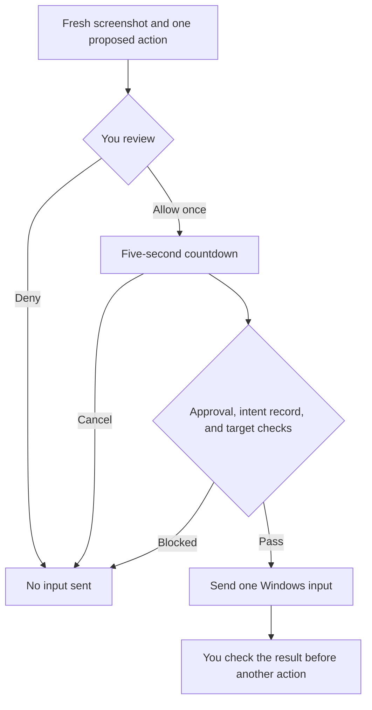

<div align="center">


# James

### Think together. Stay in control.

**A native Rust desktop companion for local AI.**<br />
Talk through an idea. Ask about your screen. Decide what happens next.

[](docs/END_USER_READINESS.md)
[](crates/james-desktop/Cargo.toml)
[](LICENSE)
[](https://github.com/topherchris420/james/actions/workflows/ci.yml)
[](https://github.com/topherchris420/james/actions/workflows/desktop.yml)

**[Download James](https://github.com/topherchris420/james/releases)** · **[Get started](#get-started)** · [Capabilities](#what-you-can-do) · [Privacy](#privacy-and-control) · [Evidence](#what-has-been-verified) · [Build from source](#build-and-contribute)


<sub>James 0.4.0 with Gemma 3 4B through Ollama, running on Linux. An unedited model response from the <a href="docs/VALIDATION.md#end-user-release-session-2026-10-12">documented validation session</a>.</sub>

</div>

---

James brings conversation, screen guidance, voice, and carefully reviewed computer input into one desktop app. You choose the model and run it through a local model app such as Ollama, LM Studio, or llama.cpp. James provides the interface, the context you choose to share, and the controls around every action.

Built by [Vers3Dynamics](https://vers3dynamics.com/), James is free and open source. It requires no James account, includes no analytics, and connects directly only to services on your own computer. It also offers an optional, read-only window into [R.A.I.N. Lab](#a-window-into-rain-lab).

> **Intelligence may propose. Evidence must be checked. Authority stays with the human.**

> [!IMPORTANT]
> **James is a developer preview.** Windows and macOS downloads are unsigned; hands-on platform validation is still incomplete. [Review the evidence](#what-has-been-verified) before relying on it.
>
> This README describes `main`. Published downloads are currently [`v0.4.0-preview.3`](https://github.com/topherchris420/james/releases/tag/v0.4.0-preview.3). Conversation export, fresh-start controls, and recent review/privacy hardening are [unreleased changes](CHANGELOG.md#unreleased); [build from source](#build-and-contribute) to use them.

## What you can do

| You want to… | James helps you… |
| --- | --- |
| **Think something through** | Chat with your chosen model, watch replies stream in, and read formatted explanations or copyable code. Stop a reply and keep the text that arrived. |
| **Understand what is on screen** | Capture and preview your primary screen, then attach it to a question. Or press **Guide me** for up to three suggested next steps that you take yourself. Requires a vision model. |
| **Use your voice** | Dictate a question, hear an answer, or start a hands-free conversation with **Talk**. Recognition runs locally; macOS and Linux need whisper.cpp setup. Voice cannot approve computer input. |
| **Approve one computer action** | On Windows, prepare a click, key press, or text entry yourself, or ask the model to suggest one. Review the proposal, choose **Allow once**, then check the result. |
| **Keep a useful conversation** | Copy it as Markdown, start a new conversation, or retry an answer while preserving your unsent draft. These improvements are on `main`, awaiting the next release. |
| **Follow your research** | See the local Lab's status and recent simulator results, with evidence labels. Choose whether a compact Lab summary accompanies your chat questions. |
| **Make the interface comfortable** | Choose light, dark, or system appearance; high contrast; 80–200% text; and reduced motion. Keyboard shortcuts are listed under **F1**. Screen-reader integration is implemented but awaits hands-on validation. |

James reads capabilities reported by your model app and explains when a model cannot chat or read images. Optional **Guide me** step numbers are off by default: model-generated positions can be wrong.

### A few things to try

These are example prompts, not recorded results. Answer quality depends on your model.

| Start here | Try this |
| --- | --- |
| **Conversation** | “Help me turn this rough idea into a testable question. What evidence would change our minds?” |
| **Screen context** | Attach a screenshot: “Explain this error in plain language and suggest a first step I can check.” |
| **Guide me** | Open an unfamiliar app, then ask how to reach a setting. James suggests steps; you take them. |
| **R.A.I.N. Lab** | Enable snapshot sharing: “What did the simulator support, and what remains only a hypothesis?” |

## Get started

You need **James + a model app + a downloaded model**. The model runs separately; James does not bundle, install, or download one.

### 1. Download James for your computer

Choose an asset from the [**Releases page**](https://github.com/topherchris420/james/releases).

| Platform | Release asset |
| --- | --- |
| **Windows 10/11 · x64** | `James-<version>-windows-x64-setup.exe` — installs for your account without an administrator password. A `…-portable.exe` is also available. |
| **macOS 11+ · Apple silicon or Intel** | `James-<version>-macos-universal.zip` — extract and drag James to Applications. |
| **Ubuntu 22.04+, Debian 12+, Linux Mint 21+ · x64** | `james_<version>_amd64.deb` — open with your package installer. |
| **Other Linux · x64, glibc 2.35+** | `James-<version>-linux-x86_64.tar.gz` — extract and run `./install.sh`. |

Windows SmartScreen and macOS Gatekeeper may warn because the builds are unsigned. The [installation guide](docs/GETTING_STARTED.md#1-install-james) explains the first launch. Each release includes `SHA256SUMS.txt` and build-provenance attestations; these verify the build's origin and integrity, not operating-system trust.

### 2. Start a local model

**Ollama is a documented starting point.** The repository's validation sessions used `gemma3:4b` for chat and screen questions:

1. Install [Ollama](https://ollama.com/download) and keep its service running.
2. Download the model:

   ```bash
   ollama pull gemma3:4b
   ```

**Prefer a graphical setup?** In [LM Studio](https://lmstudio.ai/), download and load a vision model, then start its server in the **Developer** tab. James includes an LM Studio adapter; its full real-server validation remains outstanding in the [readiness ledger](docs/END_USER_READINESS.md).

Memory requirements and response speed depend on the model, context length, and hardware. Choose a model your computer can run locally. See [model compatibility](#model-compatibility) for other options.

### 3. Open James and follow the setup

James walks you through five steps: welcome, model-app setup, connection, a test message, and screen permissions. It saves your progress so you can return later.

<p align="center">


</p>

Once the test message answers, start a conversation. For speech setup, screenshots, permissions, or connection problems, follow the [complete getting started guide](docs/GETTING_STARTED.md).

## Model compatibility

James connects to a server on **the same computer**. Select a provider and local port in Settings, or use **Find my model server**.

| Model app | Default port | Evidence recorded in this repository |
| --- | --- | --- |
| [Ollama](https://ollama.com/) | `11434` | Real-server sessions with 0.40.3: chat, streaming, Stop, images, capabilities, errors, and remote-model warnings. |
| [llama.cpp `llama-server`](https://github.com/ggml-org/llama.cpp/tree/master/tools/server) | `8080` | Real-server sessions with b11564: chat, streaming, images, capabilities, and errors. |
| [LM Studio](https://lmstudio.ai/) | `1234` | Protocol fixtures and a later, limited [Guide me marker experiment](CHANGELOG.md#040-preview3--2026-10-12). Full provider validation remains open. |
| Other OpenAI-compatible servers | Configurable | Protocol fixtures; an earlier llama-cpp-python session. Compatibility depends on the server. |

These are recorded test versions, not minimum-version promises. See the [platform and provider matrix](docs/PLATFORM_SUPPORT.md) for detail. Authenticated model servers are not currently supported.

**A local connection is only one part of privacy.** Your model app can relay requests elsewhere. James labels models the server reports as remote and never selects them automatically, but it cannot detect an undisclosed relay. Choose and configure your model app accordingly.

## Privacy and control

### Share context deliberately

- **Local connections.** Model and Lab requests pass through [`james-loopback`](crates/james-loopback), which accepts only a port and connects to `127.0.0.1` or `::1`. There is no DNS, proxy, redirect following, telemetry, crash upload, or automatic update check.
- **Screen access when you ask.** Capture is initiated by a button press. Screenshots reach the model when you attach one, press **Guide me**, or request **Suggest one action**. James keeps no screenshot archive; platform helpers may use temporary files that are removed after reading.
- **Local conversation controls.** Settings and history live in your user data folder. You can disable history, clear a conversation, or delete James data in Settings. Files are not encrypted; another process running as your account can read them. An unresolved action record is retained until you check it.
- **Separate boundaries.** Your model app controls its own logging and any cloud relay. On `main`, model links show their full address and ask before opening in your browser; opening a link can transmit information to that site.

### One approval, one action

Windows computer control follows a deliberate sequence:



An approval is consumed once. James records the intended action before sending input and retains that record until you check the outcome. After an interruption, it shows the unresolved action and never retries it automatically. Model output and voice cannot grant approval; there is no model-accessible shell or action chain.

**The checks have limits.** Target matching depends on the window identity captured with the screenshot; when it is unavailable, James warns that checking is reduced. A window's contents or focus can still change. **Cancel**, or Esc while James has focus, stops the countdown; there is no global emergency key, and input already sent cannot be undone.

Read [Security](SECURITY.md) and [Supervision](docs/SUPERVISION.md) for the exact boundaries. James is not an operating-system sandbox.

## A window into R.A.I.N. Lab

James can accompany a local [R.A.I.N. Lab](https://github.com/topherchris420/lop-nur-twin) session. Start the Lab separately, open **R.A.I.N. Lab** in James, and choose **Find the Lab**. James remains usable when the Lab is offline.

<p align="center">

</p>

The view separates current activity, recent simulator results, replay status, and model-proposed hypotheses. Sharing a compact snapshot with your chat model is **off by default**; you can inspect exactly what would be shared before sending it.

This connection is read-only. James cannot start, steer, or approve Lab experiments. Simulator results remain simulator results, and model-written hypotheses remain hypotheses. On `main`, Lab snapshots are excluded from screen-guidance and action-proposal requests.

[Set up the Lab connection →](docs/LAB.md)

## What has been verified

James publishes its evidence alongside its source. Implementation, automated checks, and hands-on use are different levels of evidence.

| Evidence | What it establishes |
| --- | --- |
| **Real software in a Linux container** | Guided setup, real Ollama and llama.cpp responses, streaming and Stop, vision requests, package installation and upgrade, and a connection to the real local Lab. The display was virtual; this was not a physical desktop. |
| **Automated checks** | Cross-platform builds and tests, headless GUI coverage, and failure-path checks. The [2026-10-21 Windows run](docs/VALIDATION.md#conversation-reliability-checks-2026-10-21) recorded 207 passing tests and 4 ignored opt-in tests. This is a dated result, not a live test count. |
| **Still to validate** | Hands-on installation and primary workflows on physical Windows PCs and Macs; actual reviewed input into an application; full LM Studio validation; microphones, screen readers, and first-time-user experience. |
| **Release work still open** | Signed Windows/macOS releases and an independent security review. The project remains a developer preview. |

The Lab connection was exercised with an idle Lab; the results list was tested with recorded data. A successful model response does not establish scientific validity, and passing CI does not establish desktop usability.

**[Validation ledger](docs/VALIDATION.md)** · [Readiness scorecard](docs/END_USER_READINESS.md) · [Platform matrix](docs/PLATFORM_SUPPORT.md) · [Acceptance scenarios](docs/ACCEPTANCE_TESTS.md)

## When something goes wrong

| Symptom | First thing to check |
| --- | --- |
| James cannot find your model app | Start the model server and confirm its local port in Settings. |
| The server answers but has no model | Download and load a model in the model app. |
| A model cannot read your screenshot | Choose a vision-capable model. |
| The conversation exceeds the context window | Start a fresh conversation, or load the model with a larger context. |
| Talk or Dictate is unavailable | Open **Settings → Voice** for the platform's listening setup. |
| James refuses a Windows action | Read the refusal, capture a fresh screenshot, and review the target again. |
| An approved action needs checking after a restart | Inspect the named application and acknowledge the record. James will not replay it. |

The [troubleshooting guide](docs/GETTING_STARTED.md#if-something-goes-wrong) covers permissions, installation, and provider errors. [Report a reproducible problem](https://github.com/topherchris420/james/issues/new/choose), or use [private vulnerability reporting](https://github.com/topherchris420/james/security/advisories/new) for security findings.

## Build and contribute

Use **Rust 1.88 or newer** and your platform's build tools. Windows needs the Visual Studio C++ Build Tools for the MSVC toolchain; Linux needs an OpenGL driver and `libxkbcommon-x11-0`.

```bash
git clone https://github.com/topherchris420/james.git
cd james
cargo run -p james-desktop --release --locked
```

Keep your model server running. To check an Ollama connection independently of the desktop:

```bash
cargo run -p james-models --locked --example probe -- ollama --chat "Say hello"
```

### Built to be inspected

The Rust workspace forbids `unsafe` in its own crates and separates the interface, approval logic, transport, and platform operations. OS helpers and dependencies have their own boundaries, documented in [Security](SECURITY.md).

| Crate | Responsibility |
| --- | --- |
| [`james-core`](crates/james-core) | Approval policies, budgets, and dispatch supervision. No dependencies. |
| [`james-loopback`](crates/james-loopback) | Bounded local HTTP transport and cancellation. No dependencies. |
| [`james-models`](crates/james-models) | Provider discovery, capability reporting, streaming, and error classification. |
| [`james-platform`](crates/james-platform) | Screen capture, speech, local recognition, and reviewed Windows input. |
| [`james-lab`](crates/james-lab) | Read-only Lab access and summaries with evidence labels. |
| [`james-desktop`](crates/james-desktop) | The eframe/egui interface, onboarding, chat, review, and accessibility integration. |

The library crates and [license-notices tool](tools/notices) also support Rust 1.85; desktop and platform crates require 1.88.

Contributions that make James dependable on an actual person's computer are especially useful: platform test runs, accessibility findings, clearer setup instructions, and reproducible failures. Start with [Contributing](CONTRIBUTING.md), [Provenance](PROVENANCE.md), and the [acceptance scenarios](docs/ACCEPTANCE_TESTS.md).

Run the workspace checks before submitting code:

```bash
cargo fmt --all -- --check
cargo test --workspace --all-targets --locked
cargo clippy --workspace --all-targets --locked -- -D warnings
```

## Documentation

| For… | Read |
| --- | --- |
| **Your first session** | [Getting started](docs/GETTING_STARTED.md) · [Using James](docs/DESKTOP.md) |
| **Trust and verification** | [Security](SECURITY.md) · [Supervision](docs/SUPERVISION.md) · [Validation](docs/VALIDATION.md) |
| **Research integration** | [R.A.I.N. Lab](docs/LAB.md) |
| **Understanding the design** | [Architecture](docs/ARCHITECTURE.md) · [Requirements](docs/REQUIREMENTS.md) · [Research](docs/RESEARCH.md) |
| **Following development** | [Changelog](CHANGELOG.md) · [Roadmap](docs/ROADMAP.md) · [Installer and release guide](docs/INSTALLER.md) |

---

<p align="center">
<b>Your questions. Your model. Your decision.</b><br />
Built in the open by <a href="https://vers3dynamics.com/">Vers3Dynamics</a> · <a href="LICENSE">MIT License</a>
</p>

