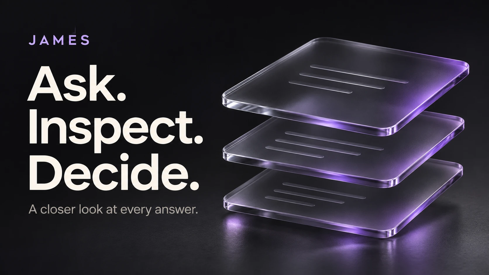
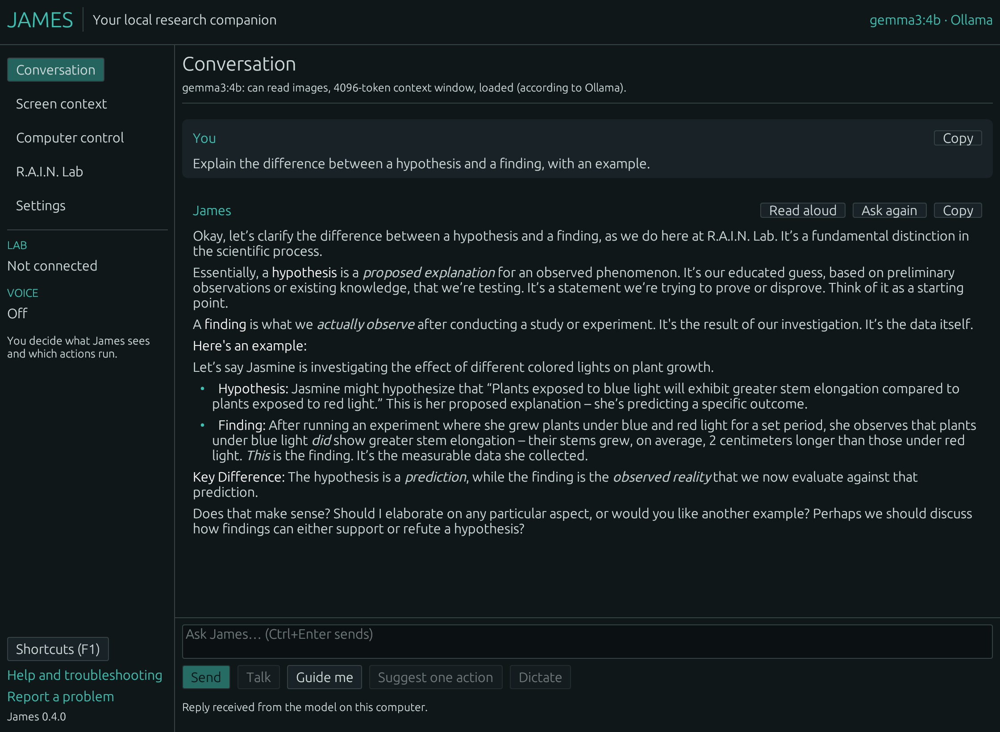

<div align="center">

# James


**An open-source desktop AI companion. Built around the model you choose.**

Chat, talk, explore your screen, and work with documents — with context you can inspect and computer input you review.

[](https://github.com/topherchris420/james/releases/tag/v0.4.0-preview.5)
[](LICENSE)
[](https://github.com/topherchris420/james/actions/workflows/ci.yml)
[](https://github.com/topherchris420/james/actions/workflows/desktop.yml)

**[Download James](https://github.com/topherchris420/james/releases/tag/v0.4.0-preview.5)** · **[Get started](#get-started)** · [Explore the features](#meet-your-desktop-companion) · [Data & control](#your-context-your-call) · [Build from source](#under-the-hood)

Windows · macOS · Linux &nbsp; / &nbsp; Native Rust desktop &nbsp; / &nbsp; No James account required

<sub>Campaign illustrations are concept artwork. The recorded application screenshot appears below. [Artwork provenance](docs/assets/marketing/README.md).</sub>

</div>

James connects to a model server running on your computer: **Ollama, LM Studio, or llama.cpp**. Choose a model, bring the context that matters, and keep the conversation close to your work. Developed by [Vers3Dynamics](https://vers3dynamics.com/), with optional read-only connections to R.A.I.N. Lab and a local Shepherd hub.

> [!NOTE]
> **Developer preview · v0.4.0-preview.5.** The current release includes live Talk follow-ups, multiple attachments, guided step checks, guarded Windows typing Undo, and the companion octopus. Platform support varies; physical Windows/macOS use, accessibility, and independent security validation remain incomplete. Read the [release notes](CHANGELOG.md#040-preview5--2026-11-15) and [platform evidence](docs/PLATFORM_SUPPORT.md).

<a id="01-the-apparatus"></a>

## Meet your desktop companion

| A little help with… | What James brings |
| --- | --- |
| **Thinking things through** | Stream answers from your chosen model. Stop a reply, ask again, copy the conversation, or search retained chat history locally. |
| **What is on your screen** | Capture on request, inspect the preview, select a region, and ask a vision-capable model. **Guide me** offers numbered instructions and a checklist you control. |
| **The files in front of you** | Attach text, extractable PDFs, and supported images. Review up to eight files before sending; inspect line references in document answers. Scanned PDFs need OCR outside James. |
| **A conversation out loud** | Use Talk, Dictate, and read aloud. Live Talk accepts follow-ups and lets you interrupt spoken replies with the Talk shortcut. Voice setup depends on your platform. |
| **Keeping your place** | Summon a compact conversation view or open the floating octopus companion with a timer and reminders. Timers and reminder delivery require James to stay open. |
| **Taking a deliberate next step** | On Windows, review one proposed click, key, or text entry before allowing it. Guidance and spoken replies never authorize input. |
| **A team for bigger tasks** *(unreleased)* | Give a task to four persistent assistants — Coordinator, Researcher, Writer, Reviewer — that delegate within bounds, read only the folder you choose, keep notes you can inspect or forget, and write a file only after you approve its exact content. [The Team](docs/TEAM.md). |

The octopus is a small local status indicator: lavender while resting, blue while watching a timer, and coral when it finishes. The sculptural character above is its campaign interpretation; the app uses a simple illustrated companion.

<a id="what-preview5-adds"></a>
<a id="what-preview4-adds"></a>
<a id="on-main-after-preview4-unreleased"></a>

**New in preview.5:** live Talk follow-ups, optional Google Cloud speech on Windows/macOS, multiple attachments, **Check it worked** for guidance, and guarded typing Undo on Windows. Step checks are advisory; Undo is a one-shot backspace attempt, not a general rollback. [Full changelog](CHANGELOG.md) · [Desktop guide](docs/DESKTOP.md).

## Ask. Inspect. Decide.

<p align="center">

</p>

An answer is more useful when you can see what went into it.

- **Bring the source.** Attach a document or preview selected workspace text files. James supplies line-numbered text and asks the model to cite it.
- **Check the reference.** Expand **Check the sources** to read the supplied lines. Missing or invalid references are flagged. A valid location does not prove the claim is supported or true.
- **Inspect the request.** **Request evidence** shows the latest chat's model, prepared text messages, source snapshots, omitted history, and completion state. Explicitly copy the record or forget it. It stays in memory and is not saved with chat history.

Source attachments belong to one question; reattach them for a source-based follow-up. Model answers that quote a source still follow your conversation-history setting. [How request evidence works](docs/REQUEST_EVIDENCE.md).

### See the app

<p align="center">

</p>

<p align="center"><sub>Actual application capture from the 12 October 2026 Linux validation session; the interface predates preview.5. The model's answer is a demonstration, not a verified scientific finding. <a href="docs/VALIDATION.md#end-user-release-session-2026-10-12">Read the session record</a>.</sub></p>

<a id="03-first-operation"></a>

## Get started

You need **James + a running model server + a downloaded model**. James does not bundle or install the model.

### 1. Download the preview

Choose a package from [v0.4.0-preview.5](https://github.com/topherchris420/james/releases/tag/v0.4.0-preview.5).

| Your computer | Release asset |
| --- | --- |
| Windows 10/11, x64 | `James-0.4.0-preview.5-windows-x64-setup.exe` or `…-portable.exe` |
| macOS 11+, Apple silicon or Intel | `James-0.4.0-preview.5-macos-universal.zip` |
| Ubuntu 22.04+, Debian 12+, Mint 21+, x64 | `james_0.4.0-preview.5_amd64.deb` |
| Other Linux x64, glibc 2.35+ | `James-0.4.0-preview.5-linux-x86_64.tar.gz` |

Windows and macOS downloads are unsigned. Check `SHA256SUMS.txt` and the available build-provenance attestations on the release. These verify integrity and build origin, not software safety. **Windows ARM has no native package; x64 emulation is untested.** [Installation details](docs/INSTALLER.md) · [Platform support](docs/PLATFORM_SUPPORT.md).

### 2. Start your model server

For the documented Ollama setup, install [Ollama](https://ollama.com/download), keep it running, and download the model used in the recorded demonstration:

```bash
ollama pull gemma3:4b
```

Already have a model? Use it if your server exposes a supported chat API. Screen questions require a model that can read images.

| Server | Default port | Validation so far |
| --- | --- | --- |
| [Ollama](https://ollama.com/) | `11434` | Recorded real chat, streaming, image requests, and failure handling on Linux |
| [LM Studio](https://lmstudio.ai/) | `1234` | Protocol fixtures and a limited marker experiment; full real-server validation remains open |
| [llama.cpp](https://github.com/ggml-org/llama.cpp/tree/master/tools/server) | `8080` | Recorded real chat, streaming, image requests, and failure handling on Linux |

For a graphical setup, load a model in LM Studio and enable its **Developer** server. Authenticated model servers are not currently supported. Other OpenAI-compatible servers may work; compatibility is not universal.

### 3. Say hello

Open James and follow the five-step setup: **Welcome → Model app → Connect → Test message → Screen permissions**. If discovery fails, choose your server and local port in **Settings**, then select a model.

Try one question, inspect which model answered, and stop a long response. Then attach a document or preview a screenshot before sharing it. Configure optional voice and history retention in Settings when you are ready.

**[Follow the complete first-run guide](docs/GETTING_STARTED.md)**

<a id="04-human-control-of-computer-input"></a>

## Your context. Your call.

James asks you to choose what the model sees and review computer input before it runs.

| Boundary | What it means in practice |
| --- | --- |
| **Local model connection** | Model, Lab, and Shepherd connections use loopback addresses on this computer. A separately running server can still relay to the cloud; check its configuration. |
| **Selected context** | Screenshots are captured on request. Text, images, and documents go to the model when you submit them or request guidance. Capturing a preview alone does not send it. |
| **Optional cloud speech** | Google Cloud Text-to-Speech sends text selected for playback to Google on Windows/macOS. It is opt-in; platform speech is the default. The API key is stored locally without encryption. |
| **Local history** | Retained conversations and preferences live in local `session.json`. History can be turned off. Local files are not encrypted against another process with the same user access. |
| **One reviewed Windows input** | You review the exact proposed input. **Allow once** starts a countdown; expiry, intent-record, and target checks gate dispatch. You then inspect the result. |
| **No James telemetry** | No analytics, automatic crash upload, or automatic update checks. Model-server logs, cloud speech, and links you choose to open have their own data handling. |

**Control has limits.** James is not an OS sandbox. A target window can change after capture, input can have irreversible effects, and Esc cancels only while James has focus. There is no system-wide emergency key. Interrupted actions are shown for human reconciliation and never automatically retried. A second model's advisory review cannot authorize an action.

Windows typing Undo, when offered, expires after ten minutes and attempts backspaces against a rechecked target. Intervening edits can make restoration incorrect. It does not reverse clicks, submissions, or arbitrary OS effects.

[Security and storage details](SECURITY.md) · [Supervision contract](docs/SUPERVISION.md)

<a id="05-research-connection"></a>

## A team at your side

*Unreleased; not in preview.5.* Open **Team** (Ctrl+7), choose a workspace folder, and give a task to the Coordinator. It can hand parts to the Researcher (reads and quotes files), the Writer (drafts and proposes files) and the Reviewer (has James check every `[path:line]` citation). Each assistant uses the model you chose in Settings; every reply must be one action from a closed list, and James's own code decides whether it is allowed.

| You stay in control | How |
| --- | --- |
| **Nothing is written without you** | A proposed file shows its exact content and SHA-256. **Approve this exact change** applies it only if the file is unchanged since the proposal. |
| **Bounded delegation** | Two levels deep, four sub-tasks per task, no assistant twice on one chain, and a sub-task's budget comes out of its parent's. |
| **Inspectable memory** | Each note shows who can see it, who wrote it and which files it came from. **Forget** deletes its words. |
| **A record you can check** | Every step is one hash-chained journal entry, verified each time James opens it. After a restart, interrupted work waits for you; nothing is retried on its own. |
| **Stop at any time** | Cancel stops a task and everything below it, including a model reply in progress. Pause holds the whole team. |

Try it without a model server: `cargo run -p james-agents --example team_demo -- --approve`. With small local models (Qwen2.5 1.5B and 3B through llama.cpp) the team did **not** complete the demonstration task; the limits held and nothing was written. [Recorded runs and limits](docs/TEAM.md#demonstration-a).

## A window into the lab

Connect James to a locally running [R.A.I.N. Lab](https://github.com/topherchris420/lop-nur-twin) — **Recursive Architecture for Intelligent Nexus** — to inspect research status and evidence labels. The view separates observed activity, simulations, replay status, and hypotheses. Sharing a Lab snapshot with ordinary chat requires opt-in and preview; guidance and action proposals do not receive it.

*Unreleased:* when the Lab's operator turns on its optional `agent-interop/v1` interface, paste the read token on the Lab page to load **sealed evidence** from completed experiments. James recomputes each record's SHA-256 under the [shared specification](docs/interop/agent-interop-v1/README.md) and shows the claims, runs, challenges, limits and provenance; a record that does not match is refused. With a separate proposal token you can send one proposal after reviewing its exact text and digest; the Lab only queues it for its operator and authorizes nothing. Tokens are never saved. [Interop details](docs/LAB.md#optional-evidence-interface-agent-interopv1).

An optional [Shepherd wallboard](docs/SHEPHERD.md) shows activity from a self-hosted local coding-agent hub. James reads the feed; it does not start agents or grant them control. Agent messages remain unverified assertions, and live-hub validation is pending.

[Connect the Lab](docs/LAB.md) · [Inspect its research claims](https://github.com/topherchris420/lop-nur-twin/blob/main/docs/RESEARCH_CLAIMS.md)

<a id="02-principle-of-operation"></a>
<a id="08-build-and-inspect"></a>

## Under the hood

A native **eframe/egui** interface, a Rust workspace, and small components with distinct responsibilities. James does not expose a shell or unattended action loop to the model.

| Component | Responsibility |
| --- | --- |
| [`james-desktop`](crates/james-desktop) | Setup, conversation, context, review, companion, and accessibility hooks |
| [`james-models`](crates/james-models) | Provider adapters, discovery, capabilities, and streaming |
| [`james-loopback`](crates/james-loopback) | Bounded local transport, timeouts, and cancellation |
| [`james-core`](crates/james-core) | Review, policy contracts, and supervision |
| [`james-platform`](crates/james-platform) | Screen capture, speech, and reviewed Windows input |
| [`james-lab`](crates/james-lab) | Read-only research snapshots and provenance labels; optional `agent-interop/v1` evidence client |
| [`james-agents`](crates/james-agents) | The Team: identities, hash-chained journal, scoped memory, bounded delegation, approvals, routines, recovery |
| [`james-interop`](crates/james-interop) | The canonical JSON and SHA-256 rule shared with the R.A.I.N. Lab |

### Build from source

Use **Rust 1.88+** for the full workspace. Windows needs MSVC build tools; Linux needs an OpenGL driver and `libxkbcommon-x11-0`.

```bash
git clone https://github.com/topherchris420/james.git
cd james
cargo run -p james-desktop --release --locked
```

Run the checks used by the project:

```bash
cargo fmt --all -- --check
cargo test --workspace --all-targets --locked
cargo clippy --workspace --all-targets --locked -- -D warnings
```

With Ollama running, probe the adapter independently:

```bash
cargo run -p james-models --locked --example probe -- ollama --chat "Say hello"
```

The smaller library crates retain Rust 1.85 support. The Team's journal is an append-only, hash-chained JSON Lines file rather than the SQLite store the [architecture document](docs/ARCHITECTURE.md) proposed (ADR 009 explains why); an OS sandbox, MCP extensions and cloud models remain unbuilt.

<a id="06-verification-record"></a>

## Built in the open. Measured honestly.

| Evidence | What it establishes |
| --- | --- |
| **Recorded Linux sessions** | Real Ollama and llama.cpp chat, streaming, image requests, and failure paths in a container with a virtual display |
| **Package lifecycle checks** | Linux install, upgrade, and removal in a container; Windows/macOS/Linux package builds in CI |
| **Automated tests** | Application contracts, parsing, review/refusal paths, and headless GUI behavior on the tested commit and runner |
| **Still to validate** | Physical Windows/macOS use, real approved input into target apps, microphone workflows, screen readers, live Shepherd, and independent security assurance |

A green badge is a regression-check result, not a guarantee of model accuracy or everyday desktop reliability. The dated readiness assessment is an earlier release baseline; it is not a new score for preview.5.

[Validation ledger](docs/VALIDATION.md) · [Readiness assessment](docs/END_USER_READINESS.md) · [Platform matrix](docs/PLATFORM_SUPPORT.md) · [Acceptance scenarios](docs/ACCEPTANCE_TESTS.md)

<a id="07-failure-diagnosis"></a>

### Need a hand?

| If… | Try… |
| --- | --- |
| No model appears | Start the server, check the local port, and download or load a chat model. |
| Screen questions are unavailable | Select a model the server identifies as vision-capable. |
| A reply reaches the context limit | Start a fresh conversation, reduce attachments, or increase the server's context allowance. |
| Talk or Dictate is unavailable | Follow **Settings → Voice** and your platform's setup instructions. |
| Windows input is refused | Read the reason, capture a fresh screen, and recheck the target. Reconcile any unresolved action before continuing. |

[Full troubleshooting](docs/GETTING_STARTED.md#if-something-goes-wrong) · [Report a bug](https://github.com/topherchris420/james/issues/new/choose) · [Report a vulnerability privately](https://github.com/topherchris420/james/security/advisories/new)

<a id="09-open-engineering-work"></a>

## Make James better

The most useful contributions make a claim easier to check: a physical-device installation record, a reproducible voice or accessibility test, a real-server compatibility report, or a focused fix. Record the OS, James version, model/server versions, exact steps, and observed result — including failures.

[Contributing](CONTRIBUTING.md) · [Roadmap](docs/ROADMAP.md) · [Source provenance](PROVENANCE.md) · [Changelog](CHANGELOG.md)

---

<div align="center">

**Your model. Your context. Your call.**

Built by [Vers3Dynamics](https://vers3dynamics.com/). Free to explore. [MIT licensed](LICENSE).

</div>
