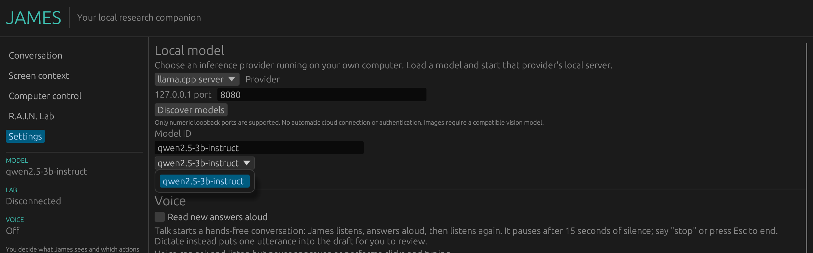

<div align="center">

# James: The Local AI Companion

### A desktop AI companion that asks before it touches anything.

**Talk to a model on your own machine. Show it your screen when *you* choose. Approve every click and keystroke before it happens.**

[](https://github.com/topherchris420/james/actions/workflows/ci.yml)
[](https://github.com/topherchris420/james/actions/workflows/desktop.yml)
[](Cargo.toml)
[](Cargo.toml)
[](docs/VALIDATION.md)
[](LICENSE)

**[Vers3Dynamics](https://vers3dynamics.com/) · [R.A.I.N. Lab](https://github.com/topherchris420/lop-nur-twin) · [Validation ledger](docs/VALIDATION.md)**

[Quick start](#quick-start) · [How James works](#how-james-works) · [What James can do](#what-james-can-do) · [Status](#status) · [FAQ](#faq) · [Documentation](#documentation)

<code>cargo run -p james-desktop --locked</code>

<br />


<sub><b>Real session, not a mockup.</b> James v0.3 built from this repository on Linux, talking to <code>Qwen2.5-3B-Instruct</code> (Q4_K_M) through a llama.cpp server on <code>127.0.0.1:8080</code>. The replies are unedited. <a href="docs/VALIDATION.md#readme-screenshot-session-2026-10-11">How this was captured</a>.</sub>

<br /><br />

</div>

---

Most desktop agents ask for your trust up front and then spend it however they
like. James works the other way round. The model can talk, look and suggest as
much as you want, but it never holds the keys. Anything that would change your
computer is a single, exact proposal that you inspect and approve once. Then
James stops and waits for you to confirm what actually happened.

James is an open-source desktop companion written in Rust. It talks only to
model servers on your own machine (LM Studio, Ollama, llama.cpp or any
OpenAI-compatible server), sees your screen only when you capture it, and
speaks and listens without a cloud service. Nothing leaves loopback.

James is also the desktop side of **[R.A.I.N. Lab](https://github.com/topherchris420/lop-nur-twin)**,
a simulated research environment. James can read the Lab's results and discuss
them with you, but it cannot steer the Lab.

> **Intelligence may propose. Evidence must be checked. Authority stays with the human.**

## Quick start

### Download the Windows preview

1. Open the [**James desktop workflow**](https://github.com/topherchris420/james/actions/workflows/desktop.yml),
   pick a **successful run on `main`**, and scroll to **Artifacts**.
2. Download one of:
   - **`James-Windows-x64-installer`**: extract and run the versioned `*-setup.exe` for a per-user install.
   - **`James-Windows-x64`**: extract and launch `james.exe` directly.
3. Start a local model server with a model loaded ([see below](#connect-a-model)).

> [!WARNING]
> These builds are **unsigned Windows x64 previews**. They contain no model
> server and no model weights. GitHub artifacts may require sign-in and expire
> after 30 days, and install, upgrade and uninstall have **not** been tested on
> a clean machine. Read the [installer guide](docs/INSTALLER.md) before sharing a build.

### Run from source

On any desktop OS, install stable Rust and your platform's native build tools
(on Windows, the MSVC toolchain and Visual Studio C++ Build Tools), then run:

```bash
git clone https://github.com/topherchris420/james.git
cd james
cargo run -p james-desktop --locked
```

On Linux, James also needs an OpenGL driver and `libxkbcommon-x11` at runtime
(`libxkbcommon-x11-0` on Debian and Ubuntu).

### Connect a model

In James, open **Settings**, choose a provider, confirm the port, press
**Discover models** and pick your model.

| Provider                | Default port | Routes James uses                                    |
| ----------------------- | ------------ | ---------------------------------------------------- |
| LM Studio               | `1234`       | `GET /v1/models`, `POST /v1/chat/completions`        |
| Ollama                  | `11434`      | native `GET /api/tags`, `POST /api/chat`             |
| llama.cpp server        | `8080`       | `GET /v1/models`, `POST /v1/chat/completions`        |
| Other OpenAI-compatible | your choice  | compatible `/v1` routes on a numeric loopback port   |

<p align="center"><br/><sub><b>Settings → Discover models</b>, asking a real llama.cpp server on loopback. The list shows whatever IDs your server reports.</sub></p>

Listing a model doesn't prove it can see images or call tools. If a provider
doesn't speak the expected routes, James reports the error instead of quietly
switching providers. See [platform support](docs/PLATFORM_SUPPORT.md) and the
[desktop guide](docs/DESKTOP.md).

### Ask James

Open **Conversation** and send a message with **Send** or **Ctrl+Enter**:

```text
I'm stuck on this settings screen. What am I looking at, and what should I try next?
```

Press **Guide me** to attach a fresh screenshot, or capture one yourself on the
**Screen context** page and preview it before attaching. Screen questions need a
vision-capable model.

### Try the approval contract without a desktop

Both examples use simulated actions, so nothing touches real input:

```bash
cargo run -p james-core --locked --example approval_demo
cargo run -p james-core --locked --example supervised_demo
```

## How James works

Every capability hangs off one loop, and only one branch of it can affect your
computer.


There is no blanket permission. Each action goes through the same five steps:

1. **Prepare.** James holds at most one allowlisted proposal with a concrete target and arguments.
2. **Review.** You see the captured screen, the exact input and the rationale. Your approval covers **that one action**.
3. **Expire.** A stale capture, a delayed dispatch or a backward clock jump voids the approval. You get a five-second focus countdown and a short, bounded grace period.
4. **Record first.** James writes and syncs an action-intent marker *before* handing input to the Windows helper.
5. **Reconcile.** Whether the input was interrupted, uncertain or apparently fine, no new action is possible until you inspect the target and acknowledge it.

Input goes to the **foreground Windows application**, not a locked target
window, so check focus yourself during the countdown. The marker is a
conservative recovery gate, not a transactional journal or proof that the
target received the input. There is no global emergency hotkey, OS sandbox or
automatic outcome check, and **Stop** cannot undo input already sent. See
[supervision](docs/SUPERVISION.md) and [security](SECURITY.md).

The supervision logic lives in [`james-core`](crates/james-core). The desktop
input boundary is [`review.rs`](crates/james-desktop/src/review.rs).

## What James can do

| Capability                  | What James does                                                                                                   | Requirements and guide                                                                     |
| --------------------------- | ----------------------------------------------------------------------------------------------------------------- | ------------------------------------------------------------------------------------------ |
| Local chat                  | Chats with a model on your machine. Replies are currently non-streaming                                          | A local model server; [desktop guide](docs/DESKTOP.md)                                     |
| Screen context              | Captures the primary screen on request, shows a preview, attaches it to a question                                | A vision-capable model; [platform support](docs/PLATFORM_SUPPORT.md)                       |
| Guide me                    | Takes one snapshot, names what matters on screen and suggests up to three steps *you* can take                    | A vision-capable model. Guidance never turns into an action                                |
| Reviewed computer input     | Prepares one click, allowlisted key or text insertion, or lets a vision model suggest one, for you to approve once | Windows x64; [supervision](docs/SUPERVISION.md)                                            |
| Talk                        | Listens, answers aloud and listens again until you say "stop", press Esc or stay quiet for 15 seconds             | Speech tools for your OS (below)                                                           |
| Dictate and read aloud      | Drops one utterance into a draft for you to edit; reads a reply with Markdown and links cleaned up                | Speech tools for your OS (below)                                                           |
| R.A.I.N. Lab context        | Reads Lab status and recent results, and attaches a bounded snapshot to a question as context, never instructions | A running Lab on loopback; [Lab guide](docs/LAB.md)                                        |

Voice has **no path** to approving an action: spoken words only ever become chat text.

Platform support:

|                               | Windows x64                    | macOS                                     | Linux                                                 |
| ----------------------------- | ------------------------------ | ----------------------------------------- | ----------------------------------------------------- |
| Chat with a local model       | ✅                             | ✅                                        | ✅                                                    |
| Screen capture and *Guide me* | ✅                             | `screencapture` (grant Screen Recording)  | gnome-screenshot, spectacle, grim or ImageMagick      |
| Listening (*Talk*, *Dictate*) | Windows speech recognition     | whisper.cpp + SoX or ffmpeg               | whisper.cpp + parec, arecord, sox or ffmpeg           |
| Spoken answers                | Installed Windows voice        | `say`                                     | espeak-ng or spd-say                                  |
| Reviewed computer input       | ✅ one action at a time        | not implemented                           | not implemented                                       |
| Build                         | Preview build and installer    | Experimental CI archive                   | Experimental CI archive                               |

On macOS and Linux, listening runs [whisper.cpp](https://github.com/ggml-org/whisper.cpp)
on your computer. James records only until you pause, never sends silence to
whisper, and deletes each utterance's temporary audio immediately.
**Settings → Voice → Set up listening** finds `whisper-cli` and a model for you
and gives copyable commands (on macOS: `brew install whisper-cpp sox`, then the
~150 MB `ggml-base.en.bin` model).

### Working with R.A.I.N. Lab

Start the Lab:

```bash
git clone https://github.com/topherchris420/lop-nur-twin.git
cd lop-nur-twin
npm ci
npm run dev
```

In James, open **R.A.I.N. Lab**, enter the port the Lab prints (usually
**5173**), press **Connect to Lab**, and enable context attachment only if you
want it. A reachable Lab may be idle; that is not evidence an experiment is
running.

| Works today                                                    | Not yet                                    |
| -------------------------------------------------------------- | ------------------------------------------ |
| `GET /api/rain/status` and `GET /api/rain/discovery` over loopback | Shared live agent memory               |
| Opt-in attachment of recent results to a question              | Starting or steering experiments           |
| Lab output labelled as research context, never instructions    | Multi-agent coordination from the desktop  |
| Simulator findings kept as simulator findings                  | Automated verification of scientific claims |

API contracts, size limits and provenance are in the [Lab guide](docs/LAB.md).

## Status

James keeps an evidence ledger instead of a feature list. Each claim sits in
the tier its evidence supports.

| Tier                                                 | Claims                                                                                                                                                                                                                                                                                                                                  |
| ---------------------------------------------------- | --------------------------------------------------------------------------------------------------------------------------------------------------------------------------------------------------------------------------------------------------------------------------------------------------------------------------------------- |
| ✅ **Verified on a real system**                     | Windows x64 preview build and installer compiled in [CI](docs/VALIDATION.md) · Windows capture and speech helpers exercised · read-only Lab status and discovery against a real Lab server · a native window launched and its guards checked · Linux model discovery and a three-turn local-model conversation through the real UI ([screenshots above](docs/VALIDATION.md#readme-screenshot-session-2026-10-11)) |
| 🧪 **Implemented and tested in CI, not on a device** | macOS/Linux capture, speech and whisper.cpp listening · Ollama and OpenAI-compatible protocol contracts (HTTP fixtures) · approval timing, expiry and clock-change regressions (simulated clocks)                                                                                                                                        |
| ⬜ **Not yet proven**                                | Real-model answer quality and vision accuracy · end-user usability and accessibility · clean-machine install, upgrade and uninstall · reliable targeting of a specific app · microphone recognition quality                                                                                                                             |

**This is a developer preview, not a production-ready autonomous agent.**
Passing CI proves code paths work, not that real-world use is flawless. The
full record is in the [validation ledger](docs/VALIDATION.md).

### What comes next

Reliability and proof come before autonomy. The next milestone is one complete
session that anyone can reproduce: converse with a real model, capture and ask
about the screen, propose one harmless input in a throwaway app, review and
allow it, reconcile the result, and ask about a Lab result with context
enabled. See the [benchmark protocol](docs/BENCHMARKS.md).

| Order     | Work                                                              | Evidence required                                                       |
| --------- | ----------------------------------------------------------------- | ----------------------------------------------------------------------- |
| **01**    | Real-model text, vision and harmless-action evaluation            | A reproducible end-to-end session with failures recorded                |
| **02**    | Streaming responses and network-level cancellation                | Malformed and disconnected stream fixtures; cancellation checks         |
| **03**    | SQLite history and a crash-tested action journal                  | Restart, interruption, rollback and replay-suppression tests            |
| **04**    | Window-specific targeting and better accessibility                | Real focus, scaling and assistive-technology tests                      |
| **05**    | Clean-machine installer, signed builds, short demo video          | Install/upgrade/uninstall matrix and an authentic recorded walkthrough  |
| **Later** | Scoped tools, MCP interoperability, coordinated research workflows | Deterministic gates, human authorization, provenance, measurable benefit |

The long-range [roadmap](docs/ROADMAP.md) is a plan, not a list of shipped features.

## FAQ

<details>
<summary><strong>Does James send anything to the cloud?</strong></summary>

No. Model and Lab clients accept only numeric `127.0.0.1` ports. There is no
cloud fallback, no environment proxy, no redirect following and no API key.
Whatever you attach goes to the local model server you chose, and that server's
own logging applies. Enforced in [`james-models`](crates/james-models) and
[`james-lab`](crates/james-lab).

</details>

<details>
<summary><strong>Is James watching my screen?</strong></summary>

No. There is no background screen watching. A capture happens only when you
press **Capture primary screen** or **Guide me**, and a manual capture is
previewed before you choose to attach it. Screenshots stay in memory; where an
OS tool needs a file, it goes to a private, owner-only temp folder and is
deleted immediately. See [`james-platform`](crates/james-platform).

</details>

<details>
<summary><strong>Can James act on my computer by itself?</strong></summary>

No. James can perform one proposed click, allowlisted key or printable text
insertion at a time, and only after you choose **Allow once**. Approvals are
single-use and expire quickly, and every action must be reconciled before the
next can be proposed. There is no shell, no file tool and no action chain.
Reviewed input is currently Windows-only.

</details>

<details>
<summary><strong>Can I approve an action by voice?</strong></summary>

No. Voice has no path to approval. Spoken words only ever become chat text.

</details>

<details>
<summary><strong>What does James keep on disk?</strong></summary>

| What                                                                     | Where                                                                                               | Kept?                                   |
| ------------------------------------------------------------------------ | --------------------------------------------------------------------------------------------------- | --------------------------------------- |
| Conversation text and settings                                           | `%LOCALAPPDATA%\Vers3Dynamics\James\session.json` on Windows, `~/.james/session.json` elsewhere | Yes, **unencrypted**                    |
| Pending action record, including the **exact text** approved for typing  | `action-intent.json`, beside the session file                                                       | Until you acknowledge the outcome       |
| Screenshots                                                              | Memory only; a private temp folder where an OS tool needs a file, deleted immediately               | No image files kept                     |
| Microphone audio                                                         | The same private temp folder for whisper.cpp, deleted after each utterance                          | Never stored, never leaves your computer |

Clearing history is not forensic deletion and does not remove an unresolved
action marker. Don't point the preview at sensitive windows or credentials until
you understand these limits. See [SECURITY.md](SECURITY.md).

</details>

<details>
<summary><strong>Which models work best?</strong></summary>

Any model your local server can run will chat. Screen questions, *Guide me* and
*Suggest one action* need a vision-capable model. Small models can answer
poorly; the [validation ledger](docs/VALIDATION.md) records examples. Model
claims carry no authority either way: the code enforces approval.

</details>

<details>
<summary><strong>How do I check that a model server is reachable?</strong></summary>

Press **Discover models** in Settings. To probe an LM Studio server from a
terminal:

```bash
pwsh -File scripts/test-local-provider.ps1 -Provider LMStudio
```

Add `-Model '<listed model ID>'` to send one real inference request.

</details>

<details>
<summary><strong>What should I do if I hit a bug?</strong></summary>

Pull the latest `main` or download a fresh build from a recent successful
[desktop workflow run](https://github.com/topherchris420/james/actions/workflows/desktop.yml).
If the problem persists, [open an issue](https://github.com/topherchris420/james/issues)
with your OS, James version, model server and model, steps to reproduce and any
error text. A well-documented failure is as useful as a feature.

</details>

## Documentation

- [Desktop guide](docs/DESKTOP.md): using the app day to day.
- [Supervision](docs/SUPERVISION.md) and [security](SECURITY.md): the safety model and its limits.
- [Validation ledger](docs/VALIDATION.md): what has actually been tested, and how.
- [Acceptance tests](docs/ACCEPTANCE_TESTS.md), [benchmarks](docs/BENCHMARKS.md) and [release readiness](docs/RELEASE_READINESS.md): how claims get proven.
- [Platform support](docs/PLATFORM_SUPPORT.md) and [installer](docs/INSTALLER.md): what runs where.
- [R.A.I.N. Lab](docs/LAB.md): API contracts, size limits and provenance.
- [Architecture](docs/ARCHITECTURE.md), [research](docs/RESEARCH.md) and [roadmap](docs/ROADMAP.md): the reasoning behind the design.

Some older docs describe earlier milestones; treat the [validation ledger](docs/VALIDATION.md)
as the current record. Report vulnerabilities through [SECURITY.md](SECURITY.md).

## Disclaimer

James is a developer preview. Reviewed input sends real clicks and keystrokes to
whichever Windows application has focus, and James cannot undo input that has
already been sent. Use non-sensitive windows and throwaway data, and keep
credentials off screen while you evaluate it. You are responsible for what you
approve.

## Contributing

Bug reports, platform tests, model fixtures, accessibility findings, doc fixes
and reproducible failure cases are all welcome. Start with
[CONTRIBUTING.md](CONTRIBUTING.md) and [PROVENANCE.md](PROVENANCE.md), and keep
reference software, recovered assets and other people's proprietary material out
of the repository.

James is Rust throughout, with fixed PowerShell helpers for native Windows
features. macOS and Linux helpers call standard system tools from fixed system
directories, never through a shell. The workspace is split into crates with one
job each:

- [`james-core`](crates/james-core): one-use approvals, policy checks, budgets, cancellation and supervised action contracts. No third-party dependencies.
- [`james-models`](crates/james-models): loopback provider selection; bounded OpenAI-compatible and Ollama requests.
- [`james-platform`](crates/james-platform): screen capture and speech on Windows, macOS and Linux; whisper.cpp listening; constrained Windows input.
- [`james-lab`](crates/james-lab): read-only status and recent research from R.A.I.N. Lab.
- [`james-desktop`](crates/james-desktop): the native `eframe`/`egui` UI, settings, local session state and review workflow.

Run the same checks as CI before sending a pull request:

```bash
cargo fmt --all -- --check
cargo test --workspace --all-targets --locked
cargo clippy --workspace --all-targets --locked -- -D warnings
```

Desktop CI runs on Windows, Ubuntu and macOS, and a core matrix covers Rust 1.85
and stable on all three. CI compilation is not an installation, native-permission
or real-device test.

## License

[MIT](LICENSE) · Built in the open by [Vers3Dynamics](https://vers3dynamics.com/)
