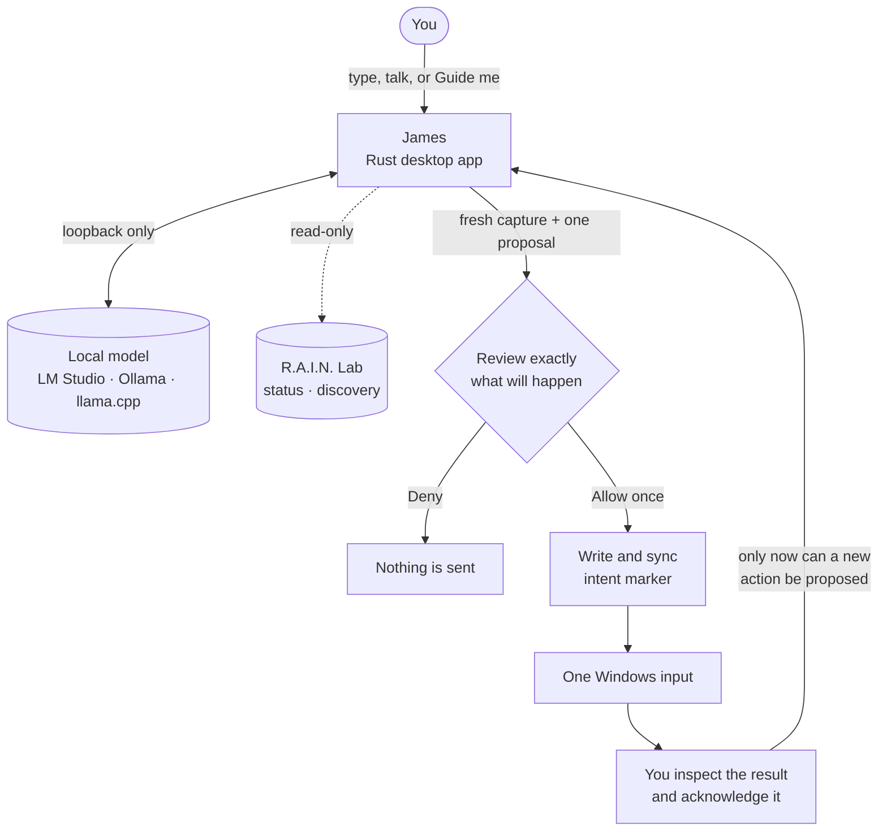

<div align="center">

# James

### The local AI companion that asks before it touches anything.

**Talk to a model on your own machine. Show it your screen when *you* choose. Review every click, key and keystroke before it happens.**

[](https://github.com/topherchris420/james/actions/workflows/ci.yml)
[](https://github.com/topherchris420/james/actions/workflows/desktop.yml)
[](LICENSE)
[](Cargo.toml)
[](docs/VALIDATION.md)

[**Quick start**](#quick-start) · [**The approval loop**](#the-loop) · [**Evidence ledger**](#status-told-honestly) · [**Privacy**](#privacy-ledger) · [**R.A.I.N. Lab**](#the-rain-lab-bridge) · [**Roadmap**](#what-comes-next)

<br/>


<sub><b>Real session, not a mockup.</b> James v0.3 built from this repository and running on Linux, connected through its <i>llama.cpp server</i> provider to <code>Qwen2.5-3B-Instruct</code> (Q4_K_M) on <code>127.0.0.1:8080</code>. Questions were typed into the composer; the replies are unedited output from a small local model. <a href="docs/VALIDATION.md#readme-screenshot-session-2026-10-11">How this was captured</a>.</sub>

</div>

---

> **Intelligence may propose. Evidence must be checked. Authority stays with the human.**

Most desktop agents ask for your trust up front and spend it however they like. **James inverts the deal.** The model can talk, look and suggest as much as you want, but it never holds the keys: every effect on your computer is a single, exact proposal that you inspect and approve once. Then James stops and waits for you to confirm what actually happened.

James is an open-source desktop companion written in Rust by [Vers3Dynamics](https://vers3dynamics.com/). It is also the desktop-facing counterpart to James in **[R.A.I.N. Lab](https://github.com/topherchris420/lop-nur-twin)**, a simulated research environment that James can read from but never steer.

## Three promises, enforced in code

| Promise | What it means | Where it's enforced |
| --- | --- | --- |
| **Nothing leaves loopback** | Model and Lab clients accept only numeric `127.0.0.1` ports. No cloud fallback, no environment proxies, no redirects, no API keys. | [`james-models`](crates/james-models), [`james-lab`](crates/james-lab) |
| **Nothing is seen unless shown** | No background screen watching. A capture happens only when you press **Capture primary screen** or **Guide me**, and a manual capture is previewed before you choose to attach it. | [`james-platform`](crates/james-platform) |
| **Nothing happens unless allowed** | One proposed click, allowlisted key or printable text at a time. One-use approval, short expiry, durable intent marker, mandatory reconciliation. No shell, no file tools, no action chains. | [`james-core`](crates/james-core), [`review.rs`](crates/james-desktop/src/review.rs) |

The workspace `forbid`s unsafe Rust. Voice has **no path** to approving an action: spoken words only ever become chat text.

<a id="the-loop"></a>
## The loop

Every capability hangs off one loop, and only one branch of it can touch your computer.



There is no blanket permission slip. A proposal needs a fresh capture, an exact review, a one-use approval and explicit reconciliation before the next one can exist. The destination is the **foreground Windows application**, not a locked target window, so check focus yourself during the five-second countdown.

## What you can do

**🗨 Ask a local model.** Pick LM Studio, Ollama, a llama.cpp server or any OpenAI-compatible server in Settings, discover its model IDs and chat. Replies are currently non-streaming.

**🖥 Bring your screen into the conversation.** Capture the primary screen, inspect the preview, attach it to a question. Needs a vision-capable model.

**🧭 Get unstuck with *Guide me*.** One snapshot; the model names what matters on screen and gives up to three steps *you* can take. Guidance never turns into an action.

**🎯 Review one action, then decide.** On the **Computer control** page, prepare a click, key or text insertion yourself, or ask a vision model to *Suggest one action*. You see the exact proposal and its rationale before choosing **Allow once** or **Deny**.

**🎙 Talk with James.** *Talk* is hands-free: James listens, answers aloud and listens again until you say "stop", press Esc, or stay quiet for 15 seconds. *Dictate* drops one utterance into a draft for you to edit. *Read last answer* speaks a reply with Markdown and links cleaned up.

**🔬 Bring research into dialogue.** Connect to a running R.A.I.N. Lab and attach a bounded snapshot of recent work to a question, treated as context, never as instructions.

### Capability map

| | Windows x64 | macOS | Linux |
| --- | --- | --- | --- |
| Chat with a local model | ✅ | ✅ | ✅ |
| Screen capture and *Guide me* | ✅ | `screencapture` (grant Screen Recording) | gnome-screenshot, spectacle, grim or ImageMagick |
| Listening (*Talk*, *Dictate*) | Windows speech recognition | whisper.cpp + SoX or ffmpeg | whisper.cpp + parec, arecord, sox or ffmpeg |
| Spoken answers | Installed Windows voice | `say` | espeak-ng or spd-say |
| Reviewed computer input | ✅ one action at a time | — not implemented | — not implemented |
| Build status | Preview build + installer | Experimental CI archive | Experimental CI archive |

On macOS and Linux, listening runs [whisper.cpp](https://github.com/ggml-org/whisper.cpp) on your computer. James records only until you pause, never sends silence to whisper, and deletes each utterance's temporary audio immediately. **Settings → Voice → Set up listening** finds `whisper-cli` and a model for you and gives copyable commands (macOS: `brew install whisper-cpp sox`, then a ~150 MB `ggml-base.en.bin` model).

## Status, told honestly

James keeps an **evidence ledger** instead of a feature list. Every claim sits in the tier its evidence actually supports.

| Tier | Claims |
| --- | --- |
| ✅ **Verified on a real system** | Windows x64 preview build and installer compiled in [CI](docs/VALIDATION.md) · Windows capture and speech helpers exercised · read-only Lab status and discovery against a real Lab server · a native window launched and its guards checked · Linux model discovery and a three-turn local-model conversation through the real UI ([screenshots above and below](docs/VALIDATION.md#readme-screenshot-session-2026-10-11)) |
| 🧪 **Implemented and tested in CI, not device-validated** | macOS/Linux capture, speech and whisper.cpp listening · Ollama and OpenAI-compatible protocol contracts (HTTP fixtures) · approval timing, expiry and clock-change regressions (simulated clocks) |
| ⬜ **Not yet proven** | Real-model answer quality and vision accuracy · end-user usability and accessibility · clean-machine install, upgrade and uninstall · reliable targeting of a specific app · microphone recognition quality |

**This is a developer preview, not a production-ready autonomous agent.** Passing CI proves code paths work, not that real-world use is flawless. The full record lives in [VALIDATION.md](docs/VALIDATION.md).

## Quick start

### Option A: Windows preview build

1. Open the [**James desktop workflow**](https://github.com/topherchris420/james/actions/workflows/desktop.yml), pick a **successful run on `main`**, and scroll to **Artifacts**.
2. Download one of:
   - **`James-Windows-x64-installer`**: extract and run the versioned `*-setup.exe` for a per-user install.
   - **`James-Windows-x64`**: extract and launch `james.exe` directly.
3. Start a local model server with a model loaded (see the table below).
4. In James, open **Settings**, choose the provider, confirm the port, press **Discover models** and pick your model.
5. Open **Conversation** and send your first message with **Send** or **Ctrl+Enter**.

> [!WARNING]
> These builds are **unsigned Windows x64 previews**. They contain no model server and no model weights, GitHub artifacts may require sign-in and expire after 30 days, and install/upgrade/uninstall has **not** been tested on a clean machine. Read the [installer guide](docs/INSTALLER.md) before sharing a build.

### Option B: Run from source (any desktop OS)

Install stable Rust and your platform's native build tools (on Windows, the MSVC toolchain and Visual Studio C++ Build Tools). On Linux, James also needs an OpenGL driver and `libxkbcommon-x11` at runtime (`libxkbcommon-x11-0` on Debian and Ubuntu).

```bash
git clone https://github.com/topherchris420/james.git
cd james
cargo run -p james-desktop --locked
```

Want to see the authorization contract with no real desktop input at all? Both examples use simulated actions:

```bash
cargo run -p james-core --locked --example approval_demo
cargo run -p james-core --locked --example supervised_demo
```

### Connect a model

| Provider | Default port | Routes James uses |
| --- | --- | --- |
| LM Studio | `1234` | `GET /v1/models`, `POST /v1/chat/completions` |
| Ollama | `11434` | native `GET /api/tags`, `POST /api/chat` |
| llama.cpp server | `8080` | `GET /v1/models`, `POST /v1/chat/completions` |
| Other OpenAI-compatible | your choice | compatible `/v1` routes on a numeric loopback port |

<p align="center"><br/><sub><b>Settings → Discover models</b>, asking a real llama.cpp-based server on loopback. The ID in the list is whatever your server reports.</sub></p>

Listing a model is not proof it can see images or call tools. If a provider doesn't speak the expected routes, James reports the error rather than switching providers silently. To probe an LM Studio server on your own machine, run `pwsh -File scripts/test-local-provider.ps1 -Provider LMStudio`, adding `-Model '<listed model ID>'` for one real inference request. More in [PLATFORM_SUPPORT.md](docs/PLATFORM_SUPPORT.md) and the [desktop guide](docs/DESKTOP.md).

## Anatomy of an approval

The supervision logic lives in [`james-core`](crates/james-core); the desktop input boundary is [`review.rs`](crates/james-desktop/src/review.rs).

1. **Prepare.** James holds at most one allowlisted proposal with a concrete target and arguments.
2. **Review.** You inspect the captured screen, the exact input and the rationale. The approval covers **that one action**.
3. **Expire.** A stale capture, a delayed dispatch or a backward wall-clock jump voids the approval. The UI gives a five-second focus countdown plus a short, bounded grace period.
4. **Record first.** James writes and syncs an action-intent marker *before* handing input to the Windows helper.
5. **Reconcile.** Whether the input was interrupted, uncertain or apparently fine, no new action is possible until you inspect the target and acknowledge it.

**What it is not:** the marker is a conservative recovery gate, not a transactional journal or proof the target received the input. There is no global emergency hotkey, guaranteed foreground targeting, OS sandbox or automatic outcome check. **Stop** cancels pending work; it cannot undo input already sent. See [SUPERVISION.md](docs/SUPERVISION.md) and [SECURITY.md](SECURITY.md).

<a id="the-rain-lab-bridge"></a>
## The R.A.I.N. Lab bridge

R.A.I.N. Lab is a separate research environment inside [Lop Nur Twin](https://github.com/topherchris420/lop-nur-twin). James is meant to be its conversational window: a place to interrogate hypotheses, weigh evidence and decide what happens next.

| Works today | Not yet |
| --- | --- |
| `GET /api/rain/status` and `GET /api/rain/discovery` over loopback | Shared live agent memory |
| Opt-in attachment of recent results to a question | Starting or steering experiments |
| Lab output labelled as research context, never instructions | Multi-agent coordination from the desktop |
| Simulator findings kept as simulator findings | Automated verification of scientific claims |

```bash
git clone https://github.com/topherchris420/lop-nur-twin.git
cd lop-nur-twin
npm ci
npm run dev
```

In James, open **R.A.I.N. Lab**, enter the port the Lab prints (usually **5173**), press **Connect to Lab**, and enable context attachment only if you want it. A reachable Lab may be idle; that is not evidence an experiment is running. API contracts, size limits and provenance are in [LAB.md](docs/LAB.md).

<a id="privacy-ledger"></a>
## Privacy ledger

Privacy is a behavior, not a badge. Here is everything James keeps, and where.

| What | Where | Kept? |
| --- | --- | --- |
| Conversation text and settings | `%LOCALAPPDATA%\Vers3Dynamics\James\session.json` on Windows, `~/.james/session.json` elsewhere | Yes, **unencrypted** |
| Pending action record, including the **exact text** approved for typing | `action-intent.json`, beside the session file | Until you acknowledge the outcome |
| Screenshots | Memory only; a private owner-only temp folder where an OS tool needs a file, deleted immediately | No image files kept |
| Microphone audio | Same private temp folder for whisper.cpp, deleted after each utterance | Never stored, never leaves your computer |
| Attached screenshots and Lab snapshots | Sent to the local model server you chose | That server's own logging applies |

Clearing history is not forensic deletion and does not remove an unresolved action marker. A local server can still log or forward what you send it, so check its configuration. Don't point the preview at sensitive windows or credentials until you understand these limits. Full scope: [SECURITY.md](SECURITY.md).

## Built as boundaries, not a monolith

| Crate | Responsibility |
| --- | --- |
| [`james-core`](crates/james-core) | One-use approvals, policy checks, budgets, cancellation, supervised action contracts. No third-party dependencies |
| [`james-models`](crates/james-models) | Loopback provider selection; bounded OpenAI-compatible and Ollama text and optional image requests |
| [`james-platform`](crates/james-platform) | Screen capture and speech on Windows, macOS and Linux; whisper.cpp listening; constrained Windows input |
| [`james-lab`](crates/james-lab) | Read-only status and recent research from R.A.I.N. Lab |
| [`james-desktop`](crates/james-desktop) | Native `eframe`/`egui` UI, settings, local session state, review workflow |

James is Rust throughout, with fixed PowerShell helpers for native Windows features. macOS and Linux helpers call standard system tools from fixed system directories, never through a shell. Design rationale is in [ARCHITECTURE.md](docs/ARCHITECTURE.md); some older docs describe earlier milestones, so treat [VALIDATION.md](docs/VALIDATION.md) as the current record.

**Reproduce the checks:**

```bash
cargo fmt --all -- --check
cargo test --workspace --all-targets --locked
cargo clippy --workspace --all-targets --locked -- -D warnings
```

Desktop CI runs on Windows, Ubuntu and macOS; a separate core matrix covers Rust 1.85 and stable on all three. CI compilation is not an installation, native-permission or real-device test. See the [platform matrix](docs/PLATFORM_SUPPORT.md) and [acceptance protocol](docs/ACCEPTANCE_TESTS.md).

## The six-step proof

The next milestone isn't a longer feature list. It is one complete, observable session that anyone can reproduce:

1. **Converse** with a real loaded model.
2. **See:** capture the primary monitor, attach it, ask what James sees.
3. **Propose** one harmless input in a disposable test app.
4. **Review** the exact proposal, verify focus, choose **Allow once**.
5. **Reconcile:** inspect what happened and acknowledge it in James.
6. **Research:** connect a running R.A.I.N. Lab and ask about an existing result with Lab context enabled.

This is a proposed acceptance test, not a completed claim. Use non-sensitive windows and throwaway data, and record the model, versions, configuration, outcome and failures. Follow the [benchmark protocol](docs/BENCHMARKS.md) and log results in the [validation ledger](docs/VALIDATION.md).

## What comes next

Reliability and proof come **before** autonomy.

| Order | Work | Evidence required |
| --- | --- | --- |
| **01** | Real-model text, vision and harmless-action evaluation | A reproducible end-to-end session with failures recorded |
| **02** | Streaming responses and network-level cancellation | Malformed and disconnected stream fixtures; cancellation checks |
| **03** | SQLite history and a crash-tested action journal | Restart, interruption, rollback and replay-suppression tests |
| **04** | Window-specific targeting and better accessibility | Real focus, scaling and assistive-technology tests |
| **05** | Clean-machine installer, signed builds, short demo video | Install/upgrade/uninstall matrix and an authentic recorded walkthrough |
| **Later** | Scoped tools, MCP interoperability, coordinated research workflows | Deterministic gates, human authorization, provenance, measurable benefit |

A wider agent runtime arrives **after** these gates, not instead of them. The long-range [roadmap](docs/ROADMAP.md) is a plan, not a list of shipped features.

## Read deeper

| If you want to… | Read |
| --- | --- |
| Use the desktop app day to day | [DESKTOP.md](docs/DESKTOP.md) |
| Understand the safety model | [SUPERVISION.md](docs/SUPERVISION.md) · [SECURITY.md](SECURITY.md) |
| Check what has actually been tested | [VALIDATION.md](docs/VALIDATION.md) · [ACCEPTANCE_TESTS.md](docs/ACCEPTANCE_TESTS.md) · [RELEASE_READINESS.md](docs/RELEASE_READINESS.md) |
| Know what runs where | [PLATFORM_SUPPORT.md](docs/PLATFORM_SUPPORT.md) · [INSTALLER.md](docs/INSTALLER.md) |
| Connect the Lab | [LAB.md](docs/LAB.md) |
| See the reasoning behind the design | [ARCHITECTURE.md](docs/ARCHITECTURE.md) · [RESEARCH.md](docs/RESEARCH.md) · [ROADMAP.md](docs/ROADMAP.md) |

## Contribute

Bug reports, platform tests, model fixtures, accessibility findings, doc fixes and reproducible failure cases are all welcome, and a well-documented failure is as valuable as a feature. Start with [CONTRIBUTING.md](CONTRIBUTING.md) and [PROVENANCE.md](PROVENANCE.md). Keep reference software, recovered assets and other people's proprietary material out of the repository.

---

<div align="center">

**The Lab explores. James helps us understand. Humans decide.**

Built in the open by [Vers3Dynamics](https://vers3dynamics.com/) · [MIT license](LICENSE)

</div>
