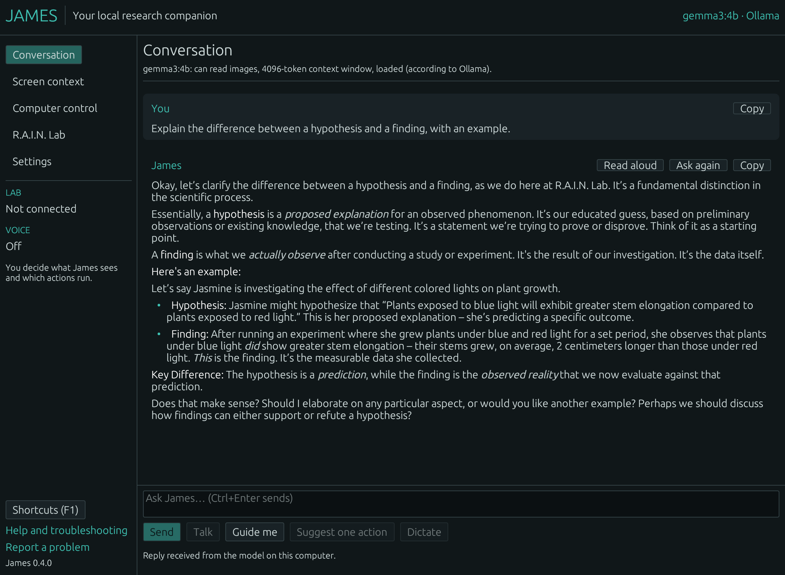
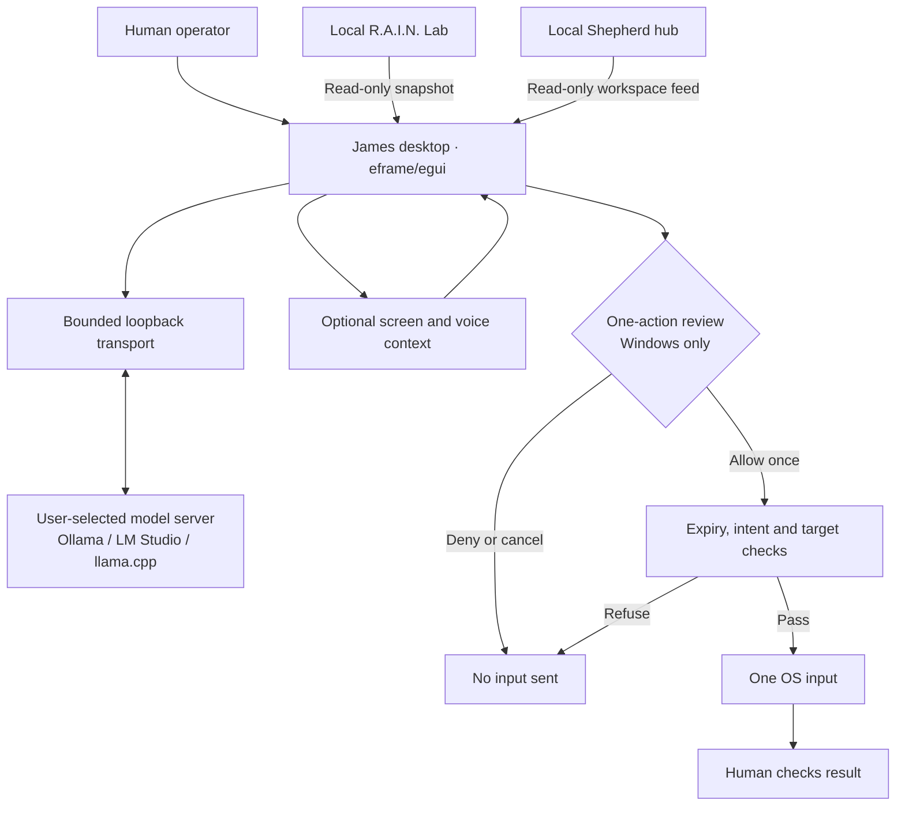
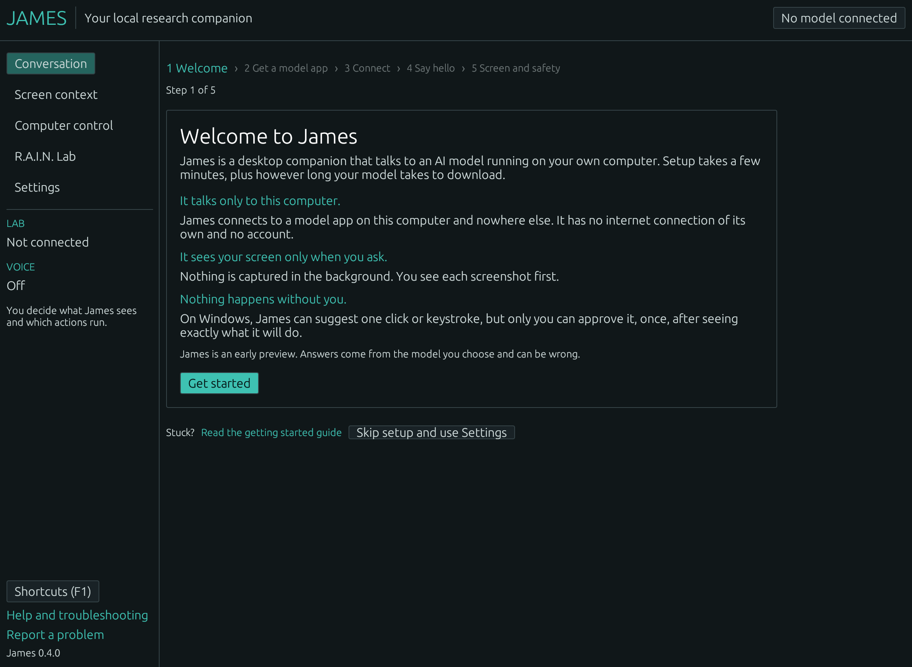
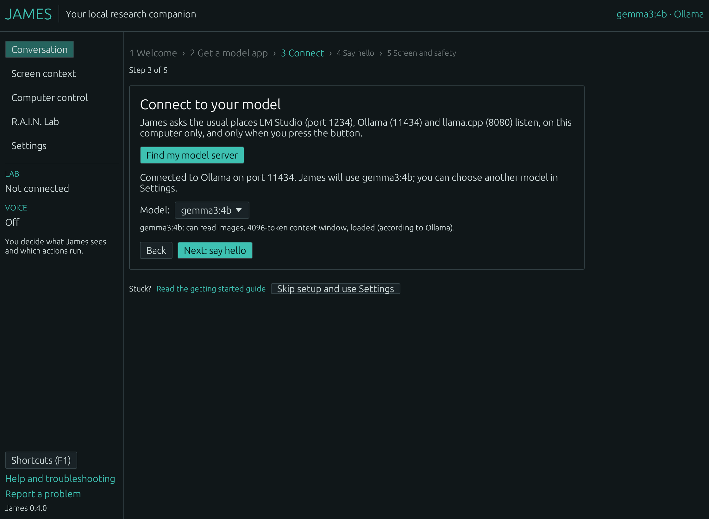
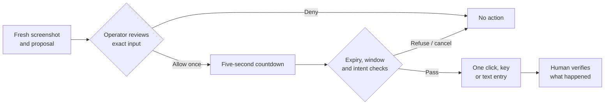
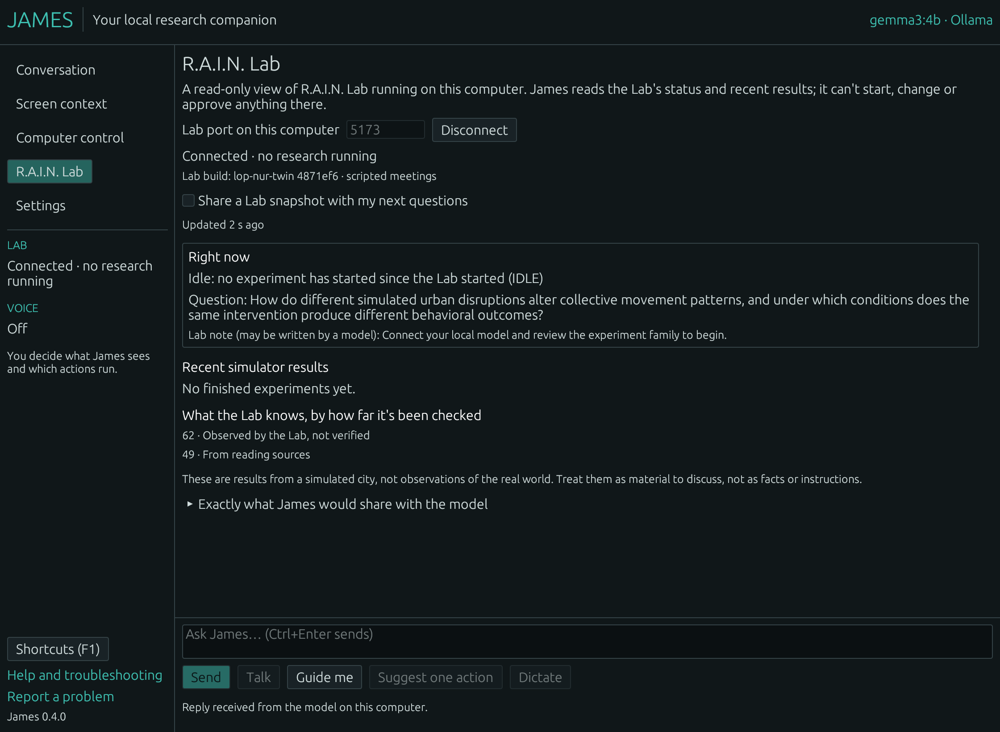

<div align="center">


# JAMES

**VERS3DYNAMICS · R.A.I.N. LAB**

### A local AI companion. A human-operated instrument.

**Choose the model. Inspect the context. Review the action. Keep control.**

[](docs/END_USER_READINESS.md)
[](crates/james-desktop/Cargo.toml)
[](LICENSE)
[](.github/workflows/ci.yml)
[](.github/workflows/desktop.yml)

**[Download](https://github.com/topherchris420/james/releases)** · **[Get started](#03-first-operation)** · [Capabilities](#01-the-apparatus) · [Architecture](#02-principle-of-operation) · [Safety](#04-human-control-of-computer-input) · [Evidence](#06-verification-record) · [Build](#08-build-and-inspect)



<sub>Actual Linux validation session with Ollama and Gemma 3 4B. This is a recorded application demonstration, not evidence that the model's answers are correct. [Examine the session](docs/VALIDATION.md#end-user-release-session-2026-10-12).</sub>

</div>

---

> **ENGINEERING PROPOSITION**
>
> An AI model can offer an explanation, describe a screen, or propose an action. None of those outputs is an authorization, and none becomes evidence merely because a model produced it.
>
> **James is designed to keep that distinction visible.**

James is an open-source Rust desktop application developed at [Vers3Dynamics](https://vers3dynamics.com/). It connects to a separately running local model service, provides conversation and optional screen and voice context, and places a human review step between any proposed computer input and its execution. A read-only connection to R.A.I.N. Lab can display research records alongside ordinary conversation. An optional [local Shepherd integration](docs/SHEPHERD.md) shows coding-agent activity without giving agents control over James.

No James account is required. James contains no analytics or automatic-update telemetry. Its own model, Lab and optional Shepherd transport is restricted to loopback addresses; the model server itself may use remote services. [The network and privacy boundary is documented here](SECURITY.md).

> [!IMPORTANT]
> **Developer preview, not a production-ready assistant.** The latest published release is [`v0.4.0-preview.3`](https://github.com/topherchris420/james/releases/tag/v0.4.0-preview.3). The current `main` branch contains **unreleased** capabilities, including conversation history, attachments, companion controls, desktop guidance, and reviewed Windows file operations. They are not necessarily in release downloads. Check the [unreleased changelog](CHANGELOG.md#unreleased) and [platform evidence matrix](docs/PLATFORM_SUPPORT.md). Windows and macOS packages are unsigned; physical-device, accessibility, and independent security validation remain incomplete.

### Pick an experiment

James is most useful when you can inspect both the result **and its boundary**.

| I want to… | First operation | What to verify |
| --- | --- | --- |
| **Talk with a chosen model** | Connect Ollama, LM Studio or llama.cpp; send a test question. | James identifies the selected model and reports connection failures instead of fabricating a reply. |
| **Ask about what is on-screen** | Capture, inspect the preview, then send a question to a vision-capable model. | Nothing is sent merely by capturing; guidance can be inaccurate. |
| **Work with a document** | On `main`, attach a text, extractable PDF or supported image; or select a workspace text-file preview. | The preview matches what you meant to share; scanned PDFs are not automatically read. |
| **Review a proposed desktop action** | On Windows, capture a fresh screen and use **Suggest one action**. | You can refuse; approval allows at most one checked input, not an unattended task. |
| **Inspect research context** | Connect a local R.A.I.N. Lab and open its read-only view. | Observations, simulations and hypotheses carry distinct labels. |
| **Watch coding agents** | On the development branch, open Shepherd and connect a self-hosted local hub with its token. | Agent claims and messages are read-only assertions, not verified changes or approvals. |

For a guided first run, follow [Getting started](docs/GETTING_STARTED.md). For exact platform support and test status, use [the capability matrix](docs/PLATFORM_SUPPORT.md), not a screenshot or a badge.

### Inspect the answer, not just the conversation

On the development branch, attach a document and ask a question. James supplies
line-numbered source text and asks the model to cite it. **Check the sources**
expands references into the actual supplied lines and flags missing or invalid
references. These checks establish a location, **not whether the claim is true**.

**Request evidence** shows the model, prepared text messages, omitted history,
source snapshots and whether the reply completed or was interrupted. Copy an
evidence record explicitly or forget it; the record stays in memory and is never
saved with chat history. **History** now searches retained titles and messages
locally. [Workflow, privacy and validation limits](docs/REQUEST_EVIDENCE.md).

## 01. The apparatus

| Assembly | Present implementation | Deliberate limit |
| --- | --- | --- |
| **Conversation** | Streams replies from a chosen model; Stop, retry, formatted text and code | James does not supply the model or certify its answers |
| **Screen context** | User-triggered capture, preview, and image questions with a vision model | No continuous screen observation; image-based guidance may be mistaken |
| **Guide me** | Up to three suggested steps, optionally annotated with model-positioned markers | Guidance only; it does not operate the application |
| **Voice** | Dictation, read-aloud, and Talk using local platform facilities | Voice cannot authorize computer input |
| **Reviewed input** | On Windows, one click, key press, or text entry after explicit review | No unattended sequence, shell, self-approval, or automatic retry |
| **R.A.I.N. Lab** | Read-only status, simulator findings, replay state and labelled hypotheses | Cannot command or approve experiments |
| **Shepherd (unreleased)** | Optional native read-only workspace feed of agent presence, claims and announcements | Self-hosted loopback hub only; does not run agents, send messages or expose MCP tools |
| **Personal controls** | History retention, conversation management, visual accessibility preferences | Files are local but not encrypted against other processes using the account |

A feature implemented on `main` is not necessarily present in the latest downloadable release. The [platform matrix](docs/PLATFORM_SUPPORT.md) distinguishes implemented functions, automated tests, and exercised real-software sessions.

### Beyond the published preview: current `main`

These features are implemented on the development branch, **not a promise about the downloadable preview**. Some still lack real-device validation.

| Area | Current development-branch behavior | Important boundary |
| --- | --- | --- |
| **Conversation** | New and resumed conversations, Copy conversation, Markdown replies and local history controls | Archive retention is bounded; disabling retention does not encrypt other stored data |
| **Screen** | Select a monitor, crop a screenshot for a chat question, add point/freehand marks, and receive up to three guidance steps | Guide me and action suggestions use full-screen context; model-positioned markers can be wrong |
| **Files & workspace** | Attach UTF-8 text, extractable PDF, PNG, JPEG or WebP; explicitly preview selected workspace text files | Attachment content is sent only with a question and is not persisted in chat history; scanned PDFs require separate OCR |
| **Companion & voice** | Always-on-top companion, configurable summon/voice shortcuts, dictation, Talk, installed reading voices, local timer and optional saved reminders | Timer/reminders require James to be running; speech never approves an action |
| **Windows desktop** | Reviewed dictation into another app, screenshot guidance overlay, companion docking and media-session controls | Platform-specific features; real-app behavior remains incompletely tested |
| **Reviewed Windows utilities** | Prepare a new text file, revise into a **new copy**, or review opening a common settings page | No overwrite of existing files, automatic editing, settings changes or agent-controlled shell |
| **Agent coordination** | Native Shepherd tab, manual connect and authenticated local wallboard polling | Token stays in memory; remote hubs, write operations and agent launching are not supported |

The [Korso replication report](docs/KORSO_REPLICATION.md) explains which interaction requirements were reconstructed from static evidence and how James implements its **own Rust behavior**. It does not claim product parity or validate Korso at runtime. Consult the [unreleased changelog](CHANGELOG.md#unreleased) for feature-level limitations.

## 02. Principle of operation

James separates five responsibilities. The model is a source of proposed content, never a source of permissions.



### Where the boundaries are enforced

- **Model transport:** [`james-loopback`](crates/james-loopback) uses port-only loopback destinations (`127.0.0.1` or `::1`), without DNS resolution, redirects or proxies. It does **not** guarantee that the separately operated model server stays offline.
- **Model adaptation:** [`james-models`](crates/james-models) discovers available models, reports capabilities, streams responses, and classifies connection and protocol failures. Unavailable vision capability is disclosed rather than assumed.
- **Human authorization:** [`james-core`](crates/james-core) implements review and supervision contracts. On Windows, the desktop also records the exact pending input before execution, then checks approval expiry and the reviewed target window.
- **Platform operations:** [`james-platform`](crates/james-platform) owns OS-specific capture, speech and reviewed Windows input. James does not provide a model-accessible shell.
- **Research context:** [`james-lab`](crates/james-lab) reads local Lab status and evidence labels. An experiment's claim remains separate from its execution and reproduction records.

### Data path and trust boundaries

| Information | When James uses it | What the boundary does **not** prove |
| --- | --- | --- |
| **Chat text and selected attachments** | Sent to the configured model server after an explicit question | A server on loopback may itself relay to cloud inference; trust its configuration |
| **Screenshots** | Captured on request, previewed locally and sent only when attached or used for guidance/action suggestion | Screenshot understanding and suggested coordinates are not verified facts |
| **Lab snapshots** | Read from a local Lab and optionally included in ordinary chat after user preview and opt-in | Lab text cannot authorize input and is not included in guidance/action proposal requests |
| **Conversation & preferences** | Stored in local `session.json` subject to the history setting | Local files are not encrypted against other processes with the same user access |
| **Approved Windows input** | One reviewed input is dispatched after countdown and target checks; intent is recorded before sending | Sent input cannot be undone; James cannot prove its intended effect occurred |

James itself has no telemetry or automatic update checks. Data-handling details, storage paths and the exact limitations of loopback transport are in [Security](SECURITY.md).

The workspace forbids `unsafe` in its own Rust crates. That prohibition does not mean operating systems, external helpers, dependencies, or model outputs have been proven safe. Consult [the security scope](SECURITY.md) and [supervision contract](docs/SUPERVISION.md).

## 03. First operation

**Required:** James, an independently running model server, and a downloaded model. James neither bundles a model nor installs one on your behalf.

### 1 · Install the preview

Use the [release assets](https://github.com/topherchris420/james/releases) for your platform.

| Platform | Package |
| --- | --- |
| Windows 10/11, x64 | `James-<version>-windows-x64-setup.exe` or portable `…-portable.exe` |
| macOS 11+, Apple silicon or Intel | `James-<version>-macos-universal.zip` |
| Ubuntu 22.04+, Debian 12+, Mint 21+, x64 | `james_<version>_amd64.deb` |
| Other Linux x64, glibc 2.35+ | `James-<version>-linux-x86_64.tar.gz` |

Windows SmartScreen or macOS Gatekeeper may display warnings because releases are unsigned. Download only from a source you trust and verify `SHA256SUMS.txt` and the available [build-provenance attestations](docs/INSTALLER.md). Checksums establish byte integrity; they do not establish that software is safe or trusted by the operating system.

Detailed instructions: [Getting started](docs/GETTING_STARTED.md#1-install-james).

### 2 · Start a model service

For the best-documented first experiment, use [Ollama](https://ollama.com/download):

```bash
ollama pull gemma3:4b
```

Keep Ollama running. The model's ability to read images depends on the selected model and its server's advertised capabilities.

For a graphical setup, [LM Studio](https://lmstudio.ai/) can download and load a model and expose it through its **Developer** server. James implements the connection, but its full real-server validation remains incomplete. The third supported route is [llama.cpp `llama-server`](https://github.com/ggml-org/llama.cpp/tree/master/tools/server).

| Service | Usual local port | Current evidence |
| --- | --- | --- |
| Ollama | `11434` | Recorded real chat, streaming, image and failure-path sessions |
| llama.cpp | `8080` | Recorded real chat, streaming, image and failure-path sessions |
| LM Studio | `1234` | Protocol fixtures and a limited marker experiment; full validation open |
| Other OpenAI-compatible servers | User-selected | Compatibility varies; fixtures do not establish universal support |

Authentication to model servers is not currently supported. James marks models a server identifies as remote; it cannot discover a relay that server conceals.

### 3 · Connect and verify

Launch James and follow the five-step onboarding: welcome, model application, connection, test message, and screen permissions.

<p align="center">


</p>

Then conduct three observations yourself:

1. Ask a question and confirm which model answered. Stop a long reply and inspect how James labels the interruption.
2. If you selected a vision-capable model, capture a screen, inspect its preview, and decide whether to attach it to a question. **Guide me** suggests steps but does not execute them.
3. Open **Settings** and inspect history retention, voice configuration, and the action-review controls before enabling anything.

Development-branch features are itemized in [the apparatus](#beyond-the-published-preview-current-main) and the [changelog](CHANGELOG.md#unreleased). The optional second-pass review of a model-proposed action is **advisory only**; it does not expand the model's authority or substitute for human approval.

## 04. Human control of computer input

Computer input is currently a **Windows-only** facility and is intentionally limited to one action at a time.



The approval is consumed once. An intent record is written before sending input. If the process is interrupted, the unresolved action is shown for human reconciliation, not automatically retried. Model output and voice cannot approve a proposal. Model-proposed actions on `main` may also receive an advisory second-model review, but that review is **not** authorization or an independent safety guarantee.

**Known limits:** Window matching can be incomplete; a window can change after capture; already-sent input cannot be undone; Esc cancels only while James has focus; no system-wide emergency key is provided. James is not an OS sandbox. See [Security](SECURITY.md) and [Supervision](docs/SUPERVISION.md).

## 05. Research connection

James provides a read-only window into a locally running [R.A.I.N. Lab](https://github.com/topherchris420/lop-nur-twin).

<p align="center">

</p>

The Lab page separates observed activity, registered or simulated results, replay status, and hypotheses proposed by research agents. An optional snapshot can accompany a chat question **only after the operator enables sharing and previews its contents**. Screen guidance and action proposals do not receive Lab snapshots.

The Lab's separate [ECHO Intelligence Metrology Bench](https://github.com/topherchris420/lop-nur-twin/blob/main/docs/ECHO_INTELLIGENCE_METROLOGY.md) now measures bounded claims about adaptive behavior on research subjects. Its first held-out plasticity comparison reported **inconclusive evidence overall** and a small regression under one severe locomotor impairment. That is a result of **Lop Nur Twin's scientific software**, not proof of James's reasoning ability and not a claim that James can execute or control the bench.

[Connect a local Lab](docs/LAB.md) · [Inspect the Lab's claims register](https://github.com/topherchris420/lop-nur-twin/blob/main/docs/RESEARCH_CLAIMS.md)

## 06. Verification record

A test result means only what its stated apparatus and conditions establish.

| Evidence class | Recorded finding | Remaining boundary |
| --- | --- | --- |
| **Real local model sessions** | Linux container with virtual display exercised Ollama and llama.cpp, streaming, Stop, image requests and error handling | Not a physical desktop validation on Windows or macOS |
| **Package lifecycle** | Linux package install, update and removal tested in a container; multiplatform build artifacts generated by CI | Physical installation and day-to-day use not independently established on every target platform |
| **Automated regression tests** | A dated Windows run on 21 October 2026 recorded **207 passing tests** and **4 ignored opt-in tests** | Counts do not imply that hardware-dependent actions or accessibility are proven |
| **Reviewed action safety** | Policy, review, refusal and recovery paths have automated coverage | Real approved input into a target app and physical interruption recovery remain to be exercised |
| **Accessibility** | AccessKit, scaling, contrast and keyboard behavior implemented and tested in part | No documented hands-on NVDA, VoiceOver or Orca validation |
| **Release integrity** | Release checksums and provenance information are generated | Windows and macOS releases are unsigned; no independent security review |

The [dated end-user readiness assessment](docs/END_USER_READINESS.md) rated James 0.4.0 **5.2 / 10, developer preview**. It is an evidence rubric, **not** a measure of AI intelligence or an updated assessment of the current `main` branch.

[Validation ledger](docs/VALIDATION.md) · [Readiness criteria](docs/END_USER_READINESS.md) · [Platform matrix](docs/PLATFORM_SUPPORT.md) · [Acceptance scenarios](docs/ACCEPTANCE_TESTS.md)

### What has not been established

James has not demonstrated production-grade desktop reliability, universal provider compatibility, fully tested Windows input, independent security assurance, screen-reader usability, or accurate answers from every model.

A passing CI badge establishes that the prescribed checks passed on that runner. It is not an end-user acceptance test.

### A reproducible evaluation, not a product demo

To assess James independently, record the **OS and device**, **James commit or release tag**, **model server and model versions**, **exact user action**, **observed output**, and **whether the result was repeated**. Useful falsification probes include: disconnecting the model mid-stream; refusing a proposed action; changing the target window before a Windows input; and reopening after an unresolved intent. Record failures as carefully as successes.

The [validation ledger](docs/VALIDATION.md) records exercised sessions. The [acceptance scenarios](docs/ACCEPTANCE_TESTS.md) and [readiness scorecard](docs/END_USER_READINESS.md) identify which claims still require physical-device or accessibility testing.

## 07. Failure diagnosis

| Observation | First check |
| --- | --- |
| No model detected | Start the model server; verify its port in Settings |
| Server connected, no model available | Download, load and select a model in that server |
| Screen question refused | Check that the chosen model supports images |
| Answer stops at context limit | Start a fresh conversation or increase the model server's context allowance |
| Dictation or Talk unavailable | Follow **Settings → Voice** and the platform setup guide |
| Windows input refused | Read the reason, capture a fresh screenshot and recheck the target |
| Action remains unresolved after interruption | Examine the target application and reconcile the saved intent manually |

[Full troubleshooting](docs/GETTING_STARTED.md#if-something-goes-wrong) · [Report a bug](https://github.com/topherchris420/james/issues/new/choose) · [Privately report a vulnerability](https://github.com/topherchris420/james/security/advisories/new)

## 08. Build and inspect

The desktop and platform crates require **Rust 1.88+**. The smaller library crates also support Rust 1.85. Windows requires MSVC build tools; Linux needs an OpenGL driver and `libxkbcommon-x11-0`.

```bash
git clone https://github.com/topherchris420/james.git
cd james
cargo run -p james-desktop --release --locked
```

With an Ollama server running, independently probe the model adapter:

```bash
cargo run -p james-models --locked --example probe -- ollama --chat "Say hello"
```

Run the repository's checks:

```bash
cargo fmt --all -- --check
cargo test --workspace --all-targets --locked
cargo clippy --workspace --all-targets --locked -- -D warnings
```

### Construction inventory

| Rust crate | Engineering responsibility |
| --- | --- |
| [`james-core`](crates/james-core) | Policy contracts, review, run supervision and bounded authority |
| [`james-loopback`](crates/james-loopback) | Local, bounded transport and request cancellation |
| [`james-models`](crates/james-models) | Provider adapters, model discovery, capabilities and streamed inference |
| [`james-platform`](crates/james-platform) | Screen capture, voice and reviewed Windows input |
| [`james-lab`](crates/james-lab) | Read-only research snapshots with provenance labels |
| [`james-desktop`](crates/james-desktop) | Native GUI, setup, conversation, review and accessibility hooks |

The current Rust workspace uses an eframe/egui desktop, local JSON session storage and bounded one-action input review. Broader multi-agent execution, SQLite journaling, and autonomous tool orchestration discussed in [the architecture document](docs/ARCHITECTURE.md) are **proposed future work**, not features shipped here.

## 09. Open engineering work

Useful contributions start where the evidence is weakest:

- Physical Windows and macOS installation, update and removal tests with reproducible records.
- Real Windows approved-input testing, denial, cancellation and interrupted-action recovery.
- Hands-on screen-reader and voice testing on supported platforms.
- Full real-server LM Studio validation and more varied local models.
- Independent security review and signed, notarized release distribution.

Submit a reproducible issue, a minimal test case, or a verified improvement. Consult [Contributing](CONTRIBUTING.md), [Provenance](PROVENANCE.md), and [the roadmap](docs/ROADMAP.md).

## Documentation register

| Subject | Record |
| --- | --- |
| First use | [Getting started](docs/GETTING_STARTED.md) · [Desktop operation](docs/DESKTOP.md) |
| Design and control | [Architecture](docs/ARCHITECTURE.md) · [Supervision](docs/SUPERVISION.md) · [Security](SECURITY.md) |
| Measurement | [Validation](docs/VALIDATION.md) · [Readiness](docs/END_USER_READINESS.md) · [Platform support](docs/PLATFORM_SUPPORT.md) |
| Research interface | [Lab connection](docs/LAB.md) |
| Release and change history | [Changelog](CHANGELOG.md) · [Installer](docs/INSTALLER.md) · [Roadmap](docs/ROADMAP.md) |

---

<div align="center">

**The model may propose. The instrument must disclose its limits. The human decides.**

[Vers3Dynamics](https://vers3dynamics.com/) · [MIT License](LICENSE)

</div>
