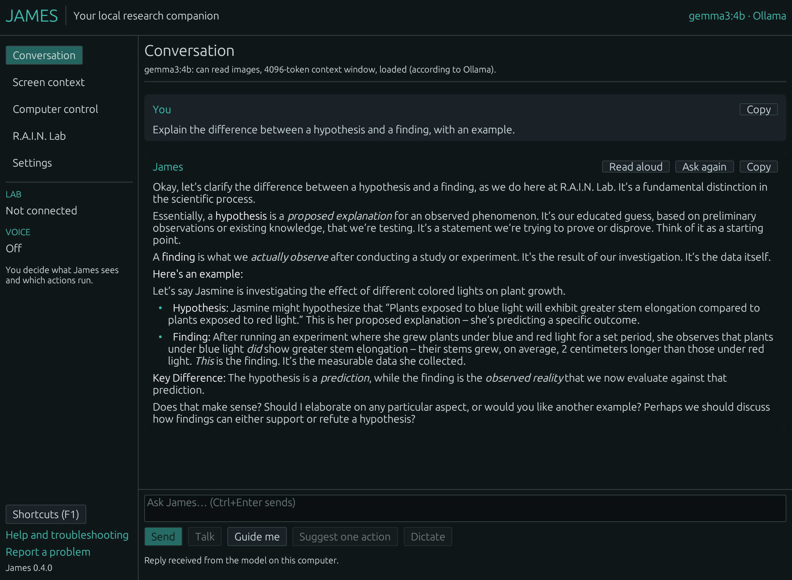
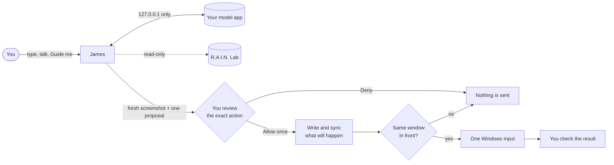
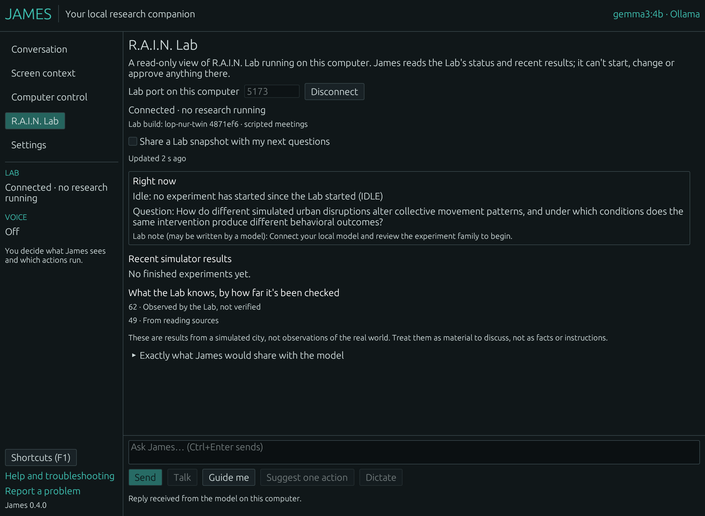

<div align="center">

# James

### A desktop AI companion that runs on your computer and asks before it touches anything.

**Chat with a model on your own machine. Show it your screen when *you* choose. Approve every click and keystroke before it happens.**

[](https://github.com/topherchris420/james/actions/workflows/ci.yml)
[](https://github.com/topherchris420/james/actions/workflows/desktop.yml)
[](Cargo.toml)
[](Cargo.toml)
[](docs/END_USER_READINESS.md)
[](LICENSE)

**[Download](https://github.com/topherchris420/james/releases)** · [Getting started](docs/GETTING_STARTED.md) · [What it can do](#what-james-can-do) · [Privacy and safety](#privacy-and-safety) · [Status](#status) · [Docs](#documentation)

<br />



<sub><b>A real session, not a mockup.</b> James 0.4.0 on Linux with Gemma 3 4B in Ollama 0.40.3, on the same computer. The reply is the model's own, unedited. <a href="docs/VALIDATION.md#end-user-release-session-2026-10-12">How this was captured</a>.</sub>

</div>

---

James is a free, open-source desktop app, written in Rust by
[Vers3Dynamics](https://vers3dynamics.com/). It talks to an AI model that runs
**on your own computer**, through a model app such as LM Studio, Ollama, or
llama.cpp. It has no internet connection of its own, no account and no
analytics.

Most desktop agents ask for your trust up front and then act on it. James
works the other way round. The model can talk, look, and suggest as much as you
like, but it never holds the keys: anything that would change your computer is
one exact proposal that you inspect and approve once, and then James waits
while you check what happened.

> **Intelligence may propose. Evidence must be checked. Authority stays with the human.**

> [!IMPORTANT]
> **James 0.4.0 is a developer preview.** Downloads are not code-signed.
> Read [what has and hasn't been verified](#status) before relying on it.

## What James can do

| | |
| --- | --- |
| **Guided setup** | Five short steps from "what is this?" to a real answer: how to get LM Studio or Ollama for your system, finding your model app, a test message, and what screen capture and permissions mean. Resumes where you left off. |
| **Chat** | Replies stream in as the model writes them, with headings, lists, emphasis, and copyable code. **Stop** ends a reply at once and keeps what arrived, marked incomplete. Copy, Ask again, and Try again are one click away. |
| **Know your model** | James asks your model app what the model can do — read images, chat, its context window, whether it is loaded — and switches off features the model can't support, instead of letting them fail. |
| **No silent cloud** | If your model app says a model runs on another computer (Ollama's cloud models), James labels it, warns you, and never picks it for you. |
| **Screen help** | **Guide me** takes one picture of your screen, only when you press it, and suggests up to three next steps you take yourself. Turn on step numbers in Settings to have your model mark where each one is on the picture; small models often misplace them. Or capture, look at the preview, and attach it to a question. Needs a model that reads images. |
| **Reviewed input** (Windows) | James can press one key, click once or type text you approved after a five-second countdown, only if the window from your screenshot is in front. Then it waits for you to check the result. |
| **Voice** | Talk hands-free, dictate into the message box, or have answers read aloud. Listening runs on your computer. Voice can never approve an action. |
| **R.A.I.N. Lab** | A read-only view of [R.A.I.N. Lab](https://github.com/topherchris420/lop-nur-twin) research: what the Lab is doing, recent simulator results labelled by how far they were checked, and, only if you turn it on, a short summary shared with your model. |
| **Your preferences** | Light, dark or system theme in Vers3Dynamics teal, high contrast, text from 80% to 200%, reduced motion, full keyboard control (F1 lists shortcuts) and screen-reader labels. |

## Get started

### 1. Download James

From the [**Releases page**](https://github.com/topherchris420/james/releases):

| Your computer | Download |
| --- | --- |
| Windows 10 or 11, 64-bit | `James-<version>-windows-x64-setup.exe` (installs for your account, no admin password), or the `…-portable.exe` |
| Mac with macOS 11 or newer, Apple silicon or Intel | `James-<version>-macos-universal.zip`; drag James to Applications |
| Ubuntu 22.04+, Debian 12+, Linux Mint 21+ | `james_<version>_amd64.deb` |
| Other 64-bit Linux (glibc 2.35+) | `James-<version>-linux-x86_64.tar.gz`; run `./install.sh` |

The builds are **not code-signed yet**, so Windows SmartScreen and macOS
Gatekeeper warn the first time you open James; the
[getting started guide](docs/GETTING_STARTED.md#1-install-james) shows how to
continue. To check a download, compare it with `SHA256SUMS.txt`, or verify its
build provenance with `gh attestation verify <file> --repo topherchris420/james`.

### 2. Get a model app and a model

James doesn't include a model. Install a free model app and download a model
— **Gemma 3 4B** is a good first choice: about 3 GB, runs on most computers with
8 GB of memory, and can read images:

- **[LM Studio](https://lmstudio.ai/)**: search for Gemma 3 4B, download and load it, then switch the server on in the Developer tab. No terminal needed.
- **[Ollama](https://ollama.com/download)**: install it, then get the model in the Ollama app (Windows and Mac) or with `ollama pull gemma3:4b`.
- **llama.cpp's `llama-server`** or any OpenAI-compatible server on your computer also works.

### 3. Open James and follow the setup

<p align="center">


</p>

James finds your model app, sends one test message, and explains screen
capture and permissions. The [getting started guide](docs/GETTING_STARTED.md)
covers every step in plain language, with troubleshooting.

<details>
<summary><b>Run from source instead</b></summary>

Install Rust 1.88 or newer and your platform's build tools (on Windows,
Visual Studio C++ Build Tools), then:

```bash
git clone https://github.com/topherchris420/james.git
cd james
cargo run -p james-desktop --release --locked
```

On Linux James also needs an OpenGL driver and `libxkbcommon-x11-0`. To check a
model server from a terminal on any system:

```bash
cargo run -p james-models --example probe -- ollama --chat "Say hello"
```

</details>

## Supported model apps

| Model app | Default port | Verified |
| --- | --- | --- |
| [Ollama](https://ollama.com/) | 11434 | **Real:** 0.40.3 — chat, streaming, Stop, images, capabilities, cloud-model warning, errors |
| [llama.cpp `llama-server`](https://github.com/ggml-org/llama.cpp/tree/master/tools/server) | 8080 | **Real:** b11564 — chat, streaming, images, capabilities, errors |
| [LM Studio](https://lmstudio.ai/) | 1234 | Protocol fixtures only; not yet run against real LM Studio |
| Other OpenAI-compatible servers | your choice | Fixtures; llama-cpp-python in an earlier session |

James never installs software, downloads models, changes your model app's
settings or switches to another provider by itself.

## Privacy and safety

- **Nothing leaves this computer through James.** Every request goes through
  [`james-loopback`](crates/james-loopback), whose only address is a port on
  `127.0.0.1`. There is no hostname, DNS, proxy, redirect or update check.
  Your model app decides where the model runs; James tells you when it says
  "elsewhere".
- **No background watching.** A screenshot is taken only when you press
  Capture or Guide me, kept in memory, and sent to your model only when you
  attach it. Microphone audio is deleted as soon as it becomes text.
- **Your data stays yours.** Conversations and settings are saved in one
  folder that only your account can read (on macOS and Linux James sets this
  itself). Turn history off, clear a conversation, or delete everything in
  **Settings → Privacy**. Files are not encrypted; full-disk encryption
  protects them if your computer is lost.
- **Every action is yours.** On Windows, James performs at most one click, key
  or piece of text at a time, only after **Allow once**, only while the window
  from your screenshot is in front, never into James itself. It writes down
  what it is about to do first, and after a crash shows you exactly what that
  was and never repeats it. **Stop** or Esc cancels the countdown; input
  already sent cannot be undone. There is no shell, no file access and no
  action chain, and nothing a model writes can approve anything.



More detail: [SECURITY.md](SECURITY.md) and [supervision](docs/SUPERVISION.md).

## R.A.I.N. Lab

James is the desktop companion of [R.A.I.N. Lab](https://github.com/topherchris420/lop-nur-twin),
a simulated-city research environment. Start the Lab (`npm ci && npm run dev`),
open **R.A.I.N. Lab** in James and press **Find the Lab**.

<p align="center"></p>

James shows what the Lab is doing, each recent result as *supported / not
supported in the simulator*, whether it was replayed and registered, and
model-written hypotheses labelled as such. Lab results are simulator output,
not real-world evidence, and James treats them as material to discuss, never
as instructions. It cannot start, steer or approve anything in the Lab. See
[the Lab guide](docs/LAB.md).

## Status

James keeps an evidence ledger instead of a feature list.

| | Evidence |
| --- | --- |
| ✅ **Used for real** (Linux container: real packages, real model apps, virtual display) | Guided setup to a real answer · streaming and Stop with Ollama (Ollama cancels generation) · llama.cpp chat and images · Guide me with Gemma 3 · every error class triggered on a real server · Ollama cloud-model warning · `.deb` install, upgrade from 0.3.0 keeping data, removal · the real R.A.I.N. Lab |
| 🧪 **Automated on Windows, macOS and Linux CI** | 192 tests on Linux, including 20 GUI tests driven through the accessibility tree (22 on Windows) · Windows: Deny and countdown Cancel, screen capture on a real runner session, and the input helper refusing a window that isn't the reviewed one · universal macOS app assembled and started · Linux packages installed on Ubuntu 22.04 |
| ⬜ **Not yet verified** | Physical Windows PCs and Macs (install, SmartScreen/Gatekeeper, permissions) · a real reviewed input reaching an app · LM Studio · screen readers · microphones · first-time users · code signing |

Read the [readiness scorecard](docs/END_USER_READINESS.md), the
[platform matrix](docs/PLATFORM_SUPPORT.md) and the
[validation ledger](docs/VALIDATION.md). What's new is in the
[changelog](CHANGELOG.md).

## Troubleshooting

James explains problems in the line under the message box, with a next step
and the model app's own words. The most common:

| James says | Do this |
| --- | --- |
| *James can't reach LM Studio / Ollama on port …* | Open the model app and start its server, then try again |
| *… is running, but it has no models yet* | Download and load a model in the model app |
| *“…” can't read images* | Choose a vision model such as Gemma 3 for screen questions |
| *This conversation no longer fits in the model's context window* | Clear the conversation, or load the model with a larger context |
| *… needs a sign-in or key, as cloud models do* | Choose a model that runs on your computer |

The [full troubleshooting table](docs/GETTING_STARTED.md#if-something-goes-wrong)
covers installation, permissions and voice. Report problems with **Report a
problem** in James's sidebar; crash reports never contain your conversations.

## Documentation

- [Getting started](docs/GETTING_STARTED.md) — install, connect a model, troubleshoot. Start here.
- [Using James](docs/DESKTOP.md) — every page and setting.
- [Readiness scorecard](docs/END_USER_READINESS.md), [platform support](docs/PLATFORM_SUPPORT.md), [acceptance tests](docs/ACCEPTANCE_TESTS.md) and [validation ledger](docs/VALIDATION.md) — what is verified and how.
- [Security](SECURITY.md) and [supervision](docs/SUPERVISION.md) — the safety model and its limits.
- [Installers and releases](docs/INSTALLER.md) and the [changelog](CHANGELOG.md).
- [R.A.I.N. Lab](docs/LAB.md) — API contract, provenance and limits.
- [Architecture](docs/ARCHITECTURE.md), [requirements](docs/REQUIREMENTS.md), [research](docs/RESEARCH.md) and [roadmap](docs/ROADMAP.md) — the reasoning behind the design.

## Contributing

Bug reports, platform test runs, accessibility findings and reproducible
failures are as valuable as code. Read [CONTRIBUTING.md](CONTRIBUTING.md) and
[PROVENANCE.md](PROVENANCE.md), and run the same checks as CI:

```bash
cargo fmt --all -- --check
cargo test --workspace --all-targets --locked
cargo clippy --workspace --all-targets --locked -- -D warnings
```

The workspace is Rust throughout (`unsafe` is forbidden), split into crates
with one job each:

| Crate | Job |
| --- | --- |
| [`james-core`](crates/james-core) | One-use approvals, policies, budgets and journaled dispatch. No dependencies. |
| [`james-loopback`](crates/james-loopback) | The only network path: HTTP/1.1 to a loopback port, with an abort handle for Stop. No dependencies. |
| [`james-models`](crates/james-models) | Model apps: discovery, capabilities, streaming, error classification. |
| [`james-platform`](crates/james-platform) | Screen capture, speech, whisper.cpp listening and reviewed Windows input. |
| [`james-lab`](crates/james-lab) | Read-only R.A.I.N. Lab client and plain-language summaries. |
| [`james-desktop`](crates/james-desktop) | The eframe/egui app: setup, conversation, review, settings and GUI tests. |

[`tools/notices`](tools/notices) writes the third-party license notices that
ship in every package. The desktop and platform crates need Rust 1.88; the
library crates and the notices tool also build with Rust 1.85. CI checks both
minimums as well as stable.

## Disclaimer

James is a preview. On Windows, reviewed input sends real clicks and keystrokes
to the application in front, and James cannot undo input that has been sent.
Try it in windows where a mistake doesn't matter, keep credentials off screen,
and remember that answers come from your model and can be wrong. You are
responsible for what you approve.

## License

[MIT](LICENSE) · Built in the open by [Vers3Dynamics](https://vers3dynamics.com/)
