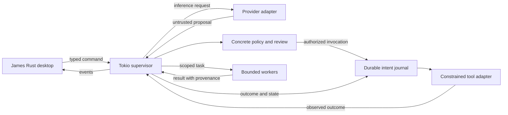
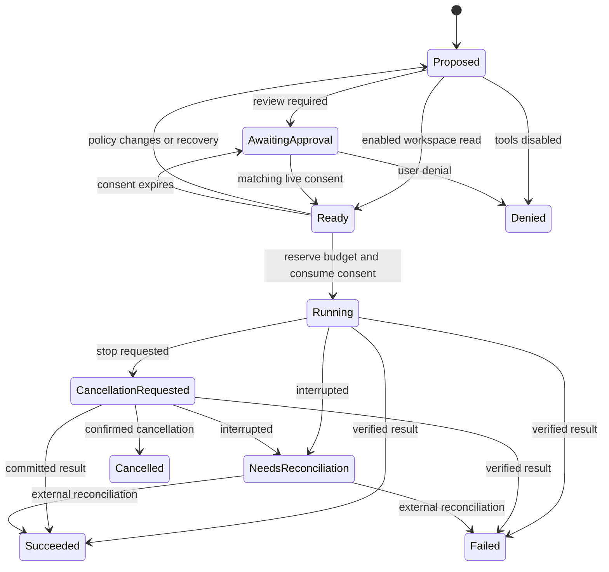

# James architecture

Status: Phase 1 design, 2026-10-11. James is an original open-source Rust desktop assistant. Reference research informs functional requirements; it does not supply source code, assets, naming, or interfaces.

## Implementation boundary

The Phase 1 implementation is a small `james-core` Rust policy and action-lifecycle prototype plus an in-memory [run supervisor](SUPERVISION.md). Its scope is immutable reviewed invocations, grants bound to one in-memory action generation and run, fail-closed recovery transitions, non-copyable run-bound budgets, and action-state contracts. The supervisor now assigns ephemeral action IDs, owns shared quotas, traces state changes, and requires a caller-supplied intent callback before dispatch. **Durable identity**, task scheduling, real resource enforcement, and committed journaling remain future work. See [VALIDATION.md](VALIDATION.md) for the actual checked behavior and limits.

The desktop, inference adapters, SQLite store, MCP client, OS sandbox, and multi-agent runtime below are **proposed later work**. A type, interface, or passing unit test is not proof that those integrations exist or enforce their intended boundary.

## ADR 001: Rust application and Rust-rendered desktop

Proposed decision: use eframe/egui for the Phase 2 desktop. The UI submits typed commands and renders events; it owns no execution permissions. Eframe supports native application startup, graphics backends, and AccessKit integration. Native OS widgets and complete accessibility are separate claims requiring platform testing. [Official eframe documentation](https://docs.rs/eframe/latest/eframe/).

Iced remains a credible alternative: its message/update/view composition and async tasks fit the same runtime boundary. Its merits should be assessed with a representative conversation, approval, and task-timeline prototype. [Official iced documentation](https://docs.rs/iced/latest/iced/).

Tauri uses a Rust core with OS WebViews rendering web content. It is suitable when a Rust backend meets the product requirement, but the proposed James UI interpretation is Rust-rendered. No framework performance ranking is asserted. [Official Tauri process model](https://v2.tauri.app/concept/process-model/).

## ADR 002: Separate domain contracts from integrations

Keep the initial prototype small. Expand only when a working vertical slice needs a boundary; the following is the intended eventual workspace, not the current crate inventory.

| Boundary | Responsibility | Must not own |
| --- | --- | --- |
| `james-core` | Task/action identities, reviewed invocations, grants, transitions, budgets, event contracts | UI, provider credentials, arbitrary I/O |
| `james-runtime` | Supervisor, task graph, deadlines, workers, cancellation, dispatch | UI-driven permission bypasses |
| `james-models` | Provider adapters, discovery, streaming, capability profiles | Tool authorization |
| `james-policy` if extracted | Resource-scoped policy and concrete authorization decisions | Model-generated permissions |
| `james-tools` | Constrained built-ins and MCP client adapters | Implicit grant expansion |
| `james-store` | Schema migrations, durable journal, snapshots, retention, export | Direct extension access to the database |
| `james-desktop` | Native window, conversation, settings, approvals, execution timeline | Blocking inference or database work |
| `james-cli` | Diagnostics and benchmark harness using shared contracts | A second policy implementation |

Proposed runtime: a Tokio supervisor owns mutable execution state. Bounded channels carry commands and events; streaming updates are coalesced without losing the authoritative outcome. Blocking filesystem work, database work, and model calls stay off the UI thread. Cancellation tokens propagate intent, while adapters separately verify whether work actually stopped. [Tokio channels](https://tokio.rs/tokio/tutorial/channels), [CancellationToken documentation](https://docs.rs/tokio-util/latest/tokio_util/sync/struct.CancellationToken.html).

## ADR 003: External inference first

Proposed first adapters are Ollama's native API and OpenAI-compatible HTTP profiles for LM Studio and llama.cpp server. This keeps GPU dependencies and model lifecycle out of James's first desktop slice. Rust-native describes James, not every optional external inference engine. [Ollama API](https://docs.ollama.com/api/introduction), [LM Studio compatibility](https://lmstudio.ai/docs/developer/openai-compat), [llama.cpp server](https://github.com/ggml-org/llama.cpp/tree/master/tools/server).

Compatibility is a tested provider/model profile. Track streaming framing, structured output, tool calls, images, context limits, usage accounting, and cancellation independently. Unsupported tool calls disable autonomous tools. Never silently change providers, send prompts to a fallback cloud service, or start a model download.

**Endpoint locality is different from inference locality.** Ollama documents cloud models used through a local server. A loopback URL alone cannot prove that prompts remain on the device. James must display both endpoint location and verified/declared/unknown inference locality. A strict local-only claim requires a verified backend configuration and tested network enforcement; James's own connection allowlist cannot stop another process from relaying data.

## ADR 004: Authorization belongs to the supervisor

Models propose actions; the supervisor validates and authorizes the concrete invocation immediately before dispatch. Review and execution must refer to the same immutable invocation. Grants bind to its run, action identity, revision, operation, resources, and lifetime. Editing arguments or expanding scope invalidates prior review. Restart invalidates transient grants; unresolved dispatches require reconciliation.

Proposed resource scopes include canonical workspace paths, network origins, tool/extension identity, provider destination, usage count, and expiry. Delegating to a worker cannot expand authority. Cancellation, revocation, or a changed policy revision must be checked again before the side-effect boundary.

Built-in file tools need explicit handling for traversal, symlinks, Windows reparse points, and races between checking and opening a file. An arbitrary subprocess inherits capabilities from the OS; validating its submitted arguments cannot constrain everything it might do afterward.

## ADR 005: Extensibility without overstating isolation

Proposed extensions use an MCP client boundary and supervised processes or authenticated remote endpoints. MCP tool metadata and output are untrusted inputs. Validate schemas, bound message sizes, apply deadlines, disambiguate tools with James-controlled server identity, and authorize data disclosure and tool calls. MCP itself does not enforce an OS sandbox. [MCP specification](https://modelcontextprotocol.io/specification/2026-07-28), [Tool requirements](https://modelcontextprotocol.io/specification/2026-07-28/server/tools).

The current specification is `2026-07-28`; request metadata and discovery differ from older initialization-based versions. Use the official Rust SDK behind an adapter, pin releases, and test supported protocol versions rather than assuming one universal handshake. [Version changes](https://modelcontextprotocol.io/specification/2026-07-28/changelog), [Official Rust SDK](https://github.com/modelcontextprotocol/rust-sdk).

Proposed process supervision includes executable identity, a restricted environment, explicit working directory, bounded stdout/stderr, resource limits, and process-tree termination. Windows Job Objects help manage process groups and limits; they are not proof of filesystem or network isolation. Until platform sandboxing is implemented and tested, installed arbitrary local extensions are **trusted code**, visibly labeled as such. [Microsoft Job Objects](https://learn.microsoft.com/en-us/windows/win32/procthread/job-objects).

James need not expose a network listener for the initial UI/runtime boundary. If a future worker uses IPC, authenticate the peer, limit message size, version the contracts, and restrict endpoint access. Remote extension connections require deliberate configuration, protected credentials, and validated destinations; redirects cannot bypass destination policy.

## ADR 006: Durable state and honest recovery

Proposed persistence: local SQLite with a single writer actor, short transactions, schema migrations, an append-only execution event journal, and reconstructible views. Use WAL only on suitable local storage. Monitor checkpoint progress and bounded retention. Use SQLite backup facilities for live backups. [SQLite WAL](https://www.sqlite.org/wal.html), [SQLite backup API](https://www.sqlite.org/backup.html).

Persist an action intent before dispatch and its outcome afterward. If James crashes after a side effect but before saving the result, the outcome is **unknown**, not failed or safe to retry. Reconcile using a remote operation identity, idempotency key, or observed artifact where supported. Otherwise stop for a concrete user decision. Do not promise exactly-once execution across arbitrary external systems.

Persist task transitions and approval invalidation atomically. On startup, identify interrupted work, invalidate transient approvals, and keep incomplete output visibly incomplete. Do not resume a destructive or externally visible action from a saved plan alone.

## ADR 007: Bounded coordination and transparency

Proposed agent coordination uses a supervisor-owned dependency graph with worker-count, depth, model-call, token, and deadline limits. Workers receive scoped context and permissions. They return structured status, evidence, artifacts, and uncertainty. No worker grants authority to another worker.

Use exclusive ownership or staged patches for shared artifacts, then reconcile conflicts centrally. Keep cancellation and budget accounting at the supervisor. Measure planner/worker/reviewer coordination against a single-agent baseline before treating extra workers as a benefit.

The user sees the selected provider/model, data destinations, action arguments, approval scope, task state, failures, and resumability. Show summaries and retained evidence; do not present private model reasoning as an execution audit.

## Data privacy and release gates

Proposed defaults: no analytics upload, no cloud fallback, no automatic workspace indexing, and no automatic extension installation. Explain retention; let users export and delete conversations, tasks, and indexed artifacts. Store provider secrets in an OS credential facility, keep secrets out of journals, and redact diagnostic exports. A plain SQLite database is not encryption at rest, and redaction requires tests.

Before a desktop release, verify the whole UI-to-policy-to-provider/tool-to-store path, keyboard and assistive-technology behavior, cancellation, crash recovery, and platform-specific path handling. Publish supported combinations and known limitations. Comparative claims are gated by the protocol in [BENCHMARKS.md](BENCHMARKS.md); no superiority result is established by this design.

## Proposed execution path

This is the later host integration. Phase 1 implements only in-memory policy/action/budget/supervisor contracts, not a durable host journal or executor.

Pre-dispatch states can also cancel. Recovery returns waiting/ready actions to Proposed and revokes issued consent. No state transition retries an unresolved side effect; the host must journal and enforce this behavior against real executors.
