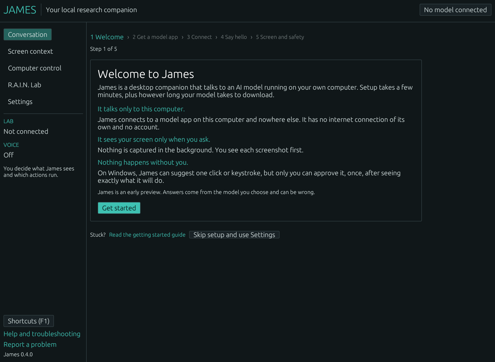
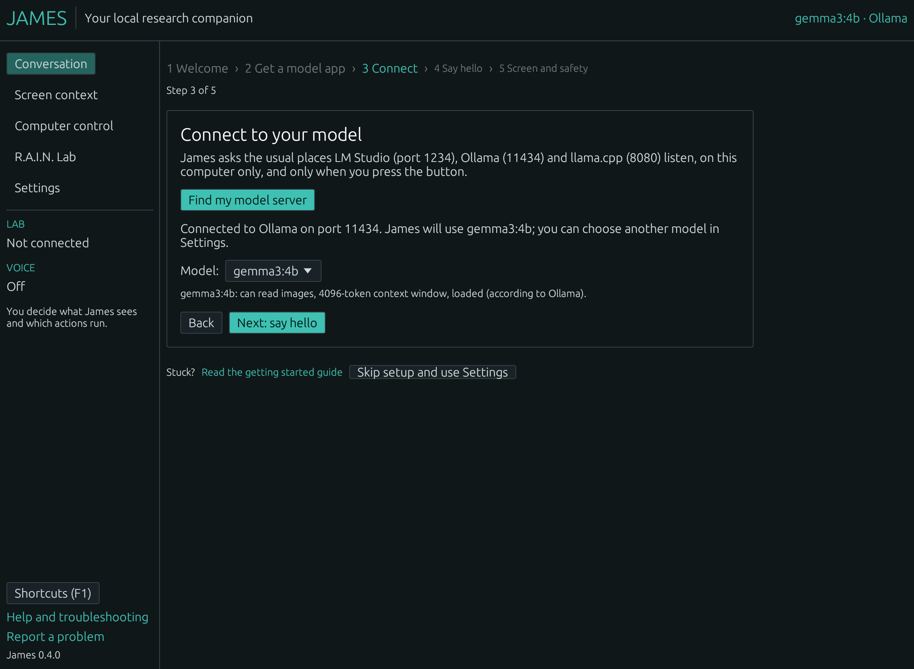
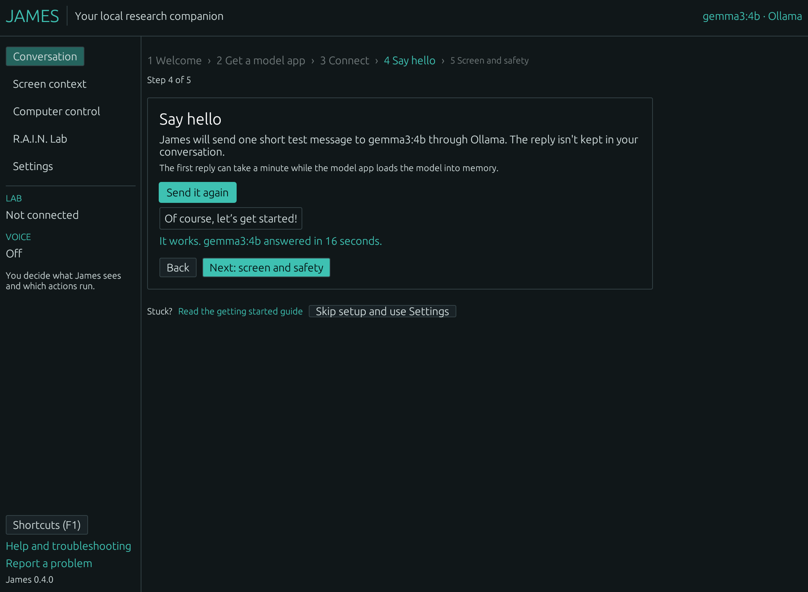

# Getting started with James

James is a desktop companion that talks to an AI model running on your own
computer. You can chat with it, show it your screen when you choose, and talk to
it out loud. James itself never connects to the internet: it talks only to a
model app on the same computer.

This guide takes about 15 minutes, most of it waiting for a model to download.
No terminal is needed if you use LM Studio.

- [What you need](#what-you-need)
- [1. Install James](#1-install-james)
- [2. Get a model app and a model](#2-get-a-model-app-and-a-model)
- [3. Set up James](#3-set-up-james)
- [4. Things to try](#4-things-to-try)
- [If something goes wrong](#if-something-goes-wrong)
- [Your data and privacy](#your-data-and-privacy)
- [Updating and uninstalling](#updating-and-uninstalling)
- [Getting help](#getting-help)

> James 0.4.0 is a **developer preview**. It has been tested with real model
> apps on Linux, but not yet on a physical Windows PC or Mac by a person. See
> [what has been verified](END_USER_READINESS.md).

## What you need

- **Windows 10 or 11** (64-bit), **macOS 11 or newer** (Apple silicon or Intel),
  or **64-bit Linux** such as Ubuntu 22.04, Debian 12, Linux Mint 21 or newer.
- **At least 8 GB of memory.** 16 GB makes answers noticeably faster. A
  graphics card helps a lot; without one, long answers can take minutes.
- **About 5 GB of free disk space** for a model.
- An internet connection to download James and a model. After that, James and
  your model work offline.

## 1. Install James

Download James from the [**Releases page**](https://github.com/topherchris420/james/releases).
Open the newest release and, under **Assets**, pick the file for your computer.

James is free and open source, but its downloads are **not code-signed yet**.
Your computer will warn you the first time you open it. The steps below show
how to get past that warning.

<details>
<summary><b>Optional: check that your download is genuine</b></summary>

- Compare its SHA-256 checksum with the line for that file in `SHA256SUMS.txt`
  on the same release page. On Windows, run `Get-FileHash <file>` in PowerShell;
  on a Mac or Linux, `shasum -a 256 <file>`.
- With the [GitHub CLI](https://cli.github.com/), `gh attestation verify <file>
  --repo topherchris420/james` confirms the file was built by this project's
  release workflow.

</details>

### Windows

1. Download **`James-…-windows-x64-setup.exe`**.
2. Open it. If **Windows protected your PC** appears, choose **More info**, then
   **Run anyway**.
3. Choose **Install**. James installs for your account only; you won't be asked
   for an administrator password.
4. Open **James** from the Start menu.

Prefer not to install anything? Download **`James-…-windows-x64-portable.exe`**
instead and open it directly.

### Mac

1. Download **`James-…-macos-universal.zip`** and open it.
2. Drag **James** into your **Applications** folder.
3. Open James. When macOS says it could not verify James, choose **Done**.
4. Open **System Settings → Privacy & Security**, scroll down, and choose
   **Open Anyway** next to the message about James. Confirm, and James opens.
   On macOS 14 and earlier you can instead Control-click James in Applications
   and choose **Open**.

You only need to do this once per version.

### Linux

- **Ubuntu, Debian, Linux Mint and similar:** download **`james_…_amd64.deb`**
  and open it with your software installer, or run
  `sudo apt install ./james_…_amd64.deb` in the folder you downloaded it to.
  Then open **James** from your applications menu.
- **Other distributions:** download **`James-…-linux-x86_64.tar.gz`**, extract
  it, and run `./install.sh` inside the folder. This installs James for your
  account only. James needs OpenGL and `libxkbcommon-x11` (install them with
  your package manager if James does not start).

## 2. Get a model app and a model

James doesn't include an AI model itself. A free model app runs the model, and
James talks to it. Pick **one**. James's setup screen shows these same steps for
your system.

### LM Studio (easiest, no terminal)

1. Download and install [LM Studio](https://lmstudio.ai/). On Linux it is an
   AppImage: allow it to run as a program, then open it.
2. In LM Studio, search for a model and download it. A good first choice is
   **Gemma 3 4B**: about 3 GB, small enough for most computers, and it can read
   pictures, which James uses for screen questions.
3. Load the model.
4. Open LM Studio's **Developer** tab and switch the server on, so its status
   says Running. Leave LM Studio open while you use James.

### Ollama

1. Download and install [Ollama](https://ollama.com/download). On Windows and
   Mac it runs in the background (system tray or menu bar); on Linux, follow the
   instructions on that page.
2. Get a model. On Windows and Mac, choose **gemma3:4b** in the Ollama app's
   model menu and send it a message to download it. Or, on any system, run this
   in a terminal:

   ```text
   ollama pull gemma3:4b
   ```

Ollama can also list *cloud* models (names ending in `-cloud`) that run on
Ollama's servers. James marks them "runs elsewhere" and never picks one for you.

Other model apps work too: anything that offers an OpenAI-compatible server on
your computer, such as llama.cpp's `llama-server`.

## 3. Set up James

Open James. The first time, it walks you through five short steps. Your
progress is saved after each one, so you can close James and come back.

<p align="center"></p>

1. **Welcome** — what James is and isn't. Choose **Get started**.
2. **Get a model app** — the steps above, for your system. When your model app
   is running, choose **My model app is running**.
3. **Connect** — James checks the usual ports of LM Studio (1234), Ollama
   (11434) and llama.cpp (8080) on this computer only. It shows the model it
   chose and what the model app says that model can do.

   <p align="center"></p>

4. **Say hello** — James sends one short test message. When you see "It works",
   your model answered. The test isn't kept in your conversation. The first
   answer can take a minute while the model app loads the model.

   <p align="center"></p>

5. **Screen and safety** — how screenshots, permissions and (on Windows)
   reviewed clicks work. You can take a practice screenshot. Choose
   **Finish setup**.

If your model app uses a different port, or James can't find it, choose **Skip
setup and use Settings**, pick your **Model app**, enter the **Port on this
computer**, press **Discover models** and pick a model. You can run the guided
setup again from **Settings → Help, updates and about**.

## 4. Things to try

- **Ask anything.** Type in the box at the bottom and press **Send** (or
  Ctrl+Enter; ⌘ Return on a Mac). The answer appears as the model writes it.
  If the model is a "thinking" model, James says so while it thinks. Not sure
  what to ask? Click one of the example questions.
- **Stop.** **Stop (Esc)** ends an answer at once and keeps what arrived,
  marked as incomplete.
- **Copy, Ask again, Read aloud** sit beside each answer. **Ask again** sends
  your last question again and replaces the answer.
- **Guide me.** Stuck on something on screen? Press **Guide me**. James hides
  for three seconds, takes one picture of your screen, and suggests up to three
  things you can try. It never clicks or types for you. This needs a model that
  can read pictures, such as Gemma 3; with other models the button is greyed
  out and says why.
- **Ask about your screen.** On **Screen context**, press **Capture primary
  screen**, look at the preview, then tick **Attach this screenshot to my next
  question** before asking.
- **Talk.** Press **Talk** to have a spoken conversation: James listens, answers
  out loud, and listens again until you say "stop" or press Esc. On Windows this
  uses Windows speech recognition. On a Mac or Linux, open **Settings → Voice →
  Set up listening** first; it gives you the commands to copy.
- **Let James press a key or click (Windows only).** On **Computer control**, you
  can prepare one click, key press or bit of typing, or capture your screen and
  press **Suggest one action** to let the model propose one. James shows you
  exactly what will happen and in which window. Nothing happens until you
  choose **Allow once**; then you have five seconds to switch to that window.
  James sends nothing if a different window is in front. After each action,
  James waits for you to check the result. Try this in a throwaway window
  first: a click or Enter can submit or delete things, and James cannot undo
  input once it is sent.
- **Make it comfortable.** **Settings → Appearance and accessibility** has
  light, dark or "match my computer", high contrast, text size and reduced
  motion. Ctrl+plus and Ctrl+minus change the size too. Press **F1** for all
  keyboard shortcuts.
- **R.A.I.N. Lab.** If you run [R.A.I.N. Lab](https://github.com/topherchris420/lop-nur-twin),
  open **R.A.I.N. Lab** and press **Find the Lab** to see its research in plain
  words. Sharing it with your model is off until you turn it on.

## If something goes wrong

James explains what happened in the line of text under the message box, says
what to do, and shows the model app's own words in brackets. A red message
also has a **Troubleshooting** link back to this table.

| James says | What to do |
| --- | --- |
| *No model server answered on this computer* | Make sure LM Studio or Ollama is open with its server started, then press **Find my model server** again. If your model app uses an unusual port, set it in **Settings**. |
| *James can't reach LM Studio on port 1234* (or Ollama, llama.cpp) | The model app isn't running, or its server is off. Start it (in LM Studio: the **Developer** tab) and press **Try again**. |
| *… is running, but it has no models yet* | Download and load a model in your model app, then try again. With Ollama, `ollama pull gemma3:4b`. |
| *… doesn't have the model “…” ready* | The model was removed or renamed in the model app. Download or load it again, or choose another model in **Settings**. |
| *“…” can't read images* | That model can't see pictures. For screen questions and **Guide me**, choose a vision model such as Gemma 3. |
| *“…” isn't a chat model* | You picked an embedding model (for example `nomic-embed-text`). Choose another model in **Settings**. |
| *This conversation no longer fits in the model's context window* | **Settings → Clear conversation…**, or load the model with a larger context length in your model app. James already leaves out old messages when it knows the model's window, and tells you when it does. |
| *… is still loading “…”* | Wait a moment and send again. |
| *… needs a sign-in or key, as cloud models do* | That is a cloud model. Choose a model that runs on this computer. |
| *… says this model runs on …, not on this computer* | Your model app sends this model's conversations to another computer. Choose a local model if you want everything to stay here. |
| *The local model server went silent for 120 seconds* / *The reply took longer than 30 minutes* | The model is too slow for this computer. Try a smaller model, or close other heavy apps. |
| **Talk** and **Dictate** are greyed out | Listening isn't set up. Hover over the button to see why, and open **Settings → Voice**. |
| *Screen capture did not return a PNG image*, or the screenshot shows only your wallpaper (Mac) | Allow James in **System Settings → Privacy & Security → Screen & System Audio Recording** (called **Screen Recording** on macOS 14 and earlier), then quit and reopen James. |
| *No screen capture tool found* (Linux) | Install a screenshot tool: `gnome-screenshot`, `spectacle`, `grim` (Wayland) or ImageMagick (X11). |
| *The window in front is not the one in your screenshot, so nothing was sent* (Windows) | Capture the screen again with the right app in front, review, and switch to it during the countdown. |
| *Check the last approved action* | James stopped while an action was pending (for example a crash). Look at the app it names, then choose **I checked the app — continue**. James never repeats it. |
| *R.A.I.N. Lab didn't answer* / *Offline… Trying again* | Start the Lab with `npm run dev`, or enter the port it prints. James keeps working without it. |
| James doesn't open on Linux | Install `libxkbcommon-x11-0` and an OpenGL driver (on Ubuntu: `sudo apt install libxkbcommon-x11-0 libgl1`). Running `james` in a terminal shows the error. |
| *James ran into an internal error in an earlier session* | James saved a short report. Please [report the problem](https://github.com/topherchris420/james/issues/new/choose) and paste the report into it; it contains no conversation text. |

## Your data and privacy

- **Everything you say to James goes only to the model app on this computer.**
  James has no way to connect anywhere else. The model app has its own
  settings: LM Studio and Ollama run models on your computer unless you choose
  a cloud model, which James labels.
- **Your conversations and settings** are saved in one folder, so they're there
  next time: `%LOCALAPPDATA%\Vers3Dynamics\James` on Windows, `~/.james` on Mac
  and Linux. Only your user account can read it (on Mac and Linux James makes
  sure of that). The files are **not encrypted**; turn on BitLocker, FileVault
  or disk encryption to protect them if your computer is lost.
- In **Settings → Privacy and your data** you can:
  - turn off **Keep my conversations on this computer** (they then disappear
    when you close James);
  - **Clear conversation…**;
  - **Delete all James data…**, which removes conversations, settings and crash
    reports and starts setup again. A record of an approved action you haven't
    checked yet is kept until you check it.
- **Screenshots** are never saved by James. A screenshot is sent to your model
  only when you attach it or press **Guide me**.
- **Microphone audio** is used only while you use Talk or Dictate and is deleted
  straight after it is turned into text.
- **Crash reports** are saved only on your computer and never sent anywhere.
- **Updates:** James never checks for updates by itself, because it never
  connects to the internet. **Settings → See the newest release** opens the
  releases page in your browser.

The [security notes](../SECURITY.md) go into more detail.

## Updating and uninstalling

To **update**, download the newest release and install it the same way. Your
conversations and settings are kept, and setup is not repeated.

- **Windows:** close James, run the new setup file. To uninstall, open
  **Settings → Apps → Installed apps → James → Uninstall**. The uninstaller asks
  whether to delete your conversations and settings too; the default is to
  keep them.
- **Mac:** quit James and replace it in Applications with the new one. macOS
  may ask again for Screen Recording or Microphone permission after an update.
  To uninstall, drag James from Applications to the Trash.
- **Linux:** install the new `.deb`, or run the new archive's `./install.sh`. To
  uninstall, run `sudo apt remove james`, or `./install.sh --uninstall` if you
  used the archive.

On Mac and Linux, uninstalling leaves your conversations behind in case you
come back. Use **Settings → Delete all James data…** before uninstalling, or
delete `~/.james` yourself (and the speech models in
`~/Library/Application Support/James` on a Mac, or `~/.local/share/james` on
Linux, if you set up listening).

## Getting help

- [Report a problem](https://github.com/topherchris420/james/issues/new/choose):
  no developer knowledge needed. Please don't include passwords, private
  conversations or screenshots of sensitive windows; reports are public.
- Report a security problem privately through
  [GitHub security advisories](https://github.com/topherchris420/james/security/advisories/new).
- James is a preview. The [validation ledger](VALIDATION.md) lists what has been
  tested on real computers and what hasn't yet.
