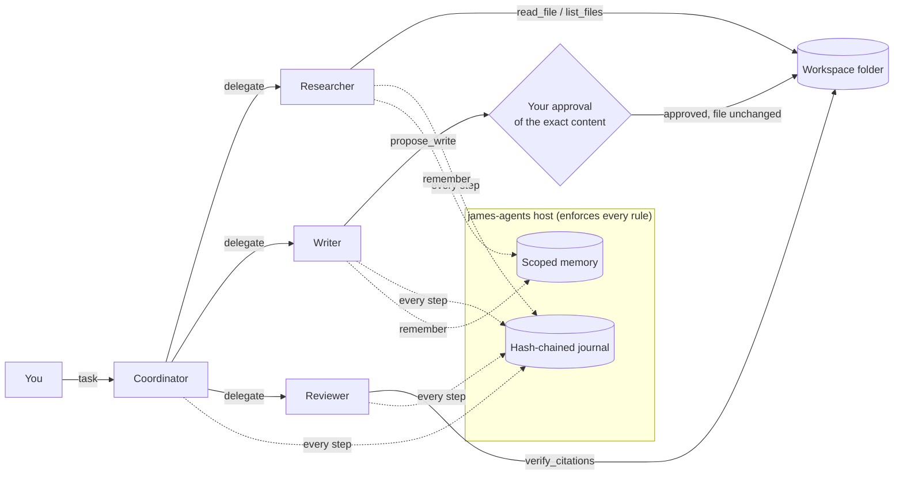

# The Team

Status: included in `v0.4.0-preview.6` (developer preview); real-model task success still depends on the selected model. Code:
[`crates/james-agents`](../crates/james-agents) (runtime),
[`crates/james-desktop/src/team_view.rs`](../crates/james-desktop/src/team_view.rs)
(Team page, Ctrl+7), [`crates/james-interop`](../crates/james-interop) (the
shared canonical-JSON rule). Design:
[`docs/superpowers/specs/2026-11-16-multi-agent-ecosystem-design.md`](superpowers/specs/2026-11-16-multi-agent-ecosystem-design.md).

James has four persistent assistants — **Coordinator, Researcher, Writer,
Reviewer** — that work on tasks you give them, using the model you chose in
Settings. They hand parts of a task to one another, read only the workspace
folder you choose, keep notes you can inspect and forget, and never write a
file until you approve its exact content.



## What the host enforces

| Rule | How |
| --- | --- |
| A model proposes; the host decides | Each reply must be one JSON action from a closed list (`list_files`, `read_file`, `verify_citations`, `delegate`, `remember`, `propose_write`, `finish`, `fail`). Anything else is refused and recorded. Nothing a model writes is executed. |
| Capabilities | Each assistant has a fixed set (`read_workspace`, `draft`, `propose_write`, `delegate`, `review`, `remember`). An action without its capability is refused. Only the person's side can register or revise an assistant; a revision is a new record. |
| Bounded delegation | Depth ≤ 2 below a task you start, ≤ 4 sub-tasks per task, no assistant twice on one chain (so A→B→A is refused instead of deadlocking), and a sub-task's step budget is carved out of its parent's remaining budget and returned when it finishes. |
| Workspace confinement | Relative paths only, no `..`, resolved through the file system so a link cannot lead outside the folder; reads ≤ 64 KiB; hidden files are not listed. |
| Approval gate | `propose_write` creates an `agent-approval/v1` request bound to the SHA-256 of the exact action (path, content digest, previous file digest). You see the content and digest; a decision is accepted only for that digest, once, before it expires (15 min). At apply time the file must still be what it was when proposed, or nothing is written. |
| Scoped memory with provenance | An entry is visible to one assistant, one task tree, or the team. Its sources are the files the task actually read (host-observed, with their SHA-256), not what a model claims. **Forget** deletes the words; the journal keeps a tombstone. A repeated identical entry is refused. |
| Routines | Five-field cron at a UTC offset you set. A routine creates a task; it never approves anything. Runs that came due while James was closed are recorded as missed and not run late. |
| Journal | Every change is one canonical `agent-event/v1` record chained to the previous one and flushed before it counts. Opening re-verifies the whole chain; an unfinished final line is set aside; any other damage refuses to open. |
| Restart | A task that was mid-step is marked interrupted and waits for you to resume it; queued work continues; an approved write that may have been cut off is reconciled by reading the file (applied, not applied, or unknown — then you are asked). Nothing with an effect is retried automatically. |
| Cancel | Cancel stops a task and everything below it, withdraws their pending proposals, and cuts an in-flight model call at once. |

There is **no OS sandbox**. These are rules James's code enforces, not
operating-system isolation. Agents do not drive the mouse or keyboard; the
existing single reviewed-input path is unchanged and separate.

## Data

Everything lives in `<James data folder>/team/`: `journal.jsonl` and
`blobs/` (memory text and proposed file contents, by digest). Model replies
and file excerpts a task read are kept in the journal so a task can resume;
Forget does not remove text a model already wrote while an entry was
visible. Nothing is uploaded. Local files are not encrypted.

## Demonstration A

```bash
cargo run -p james-agents --example team_demo -- --approve
```

```bash
cargo run -p james-agents --example team_demo -- --llama-cpp 8080 <model>
```

Without `--approve`/`--deny` the demo asks you at the terminal. It seeds a
small workspace, gives the Coordinator one task (read `docs/`, produce a
cited brief, have the reviewer check citations before the file is
proposed), prints every step, shows the exact proposal and digest, and
verifies the journal chain at the end.

Recorded runs (full transcripts in [`docs/team-demo/`](team-demo/)):

| Model | Outcome | What happened |
| --- | --- | --- |
| Scripted team (rule-based, labelled `scripted`) | Succeeded; file written after approval | 5 tasks, 16 replies; Researcher read three files and kept one team memory with their digests; the host's citation check passed 5/5; journal of 77 records verified. |
| Qwen2.5-1.5B-Instruct Q4_K_M via llama.cpp `e8fbcad` on CPU | Failed; nothing written | The Coordinator delegated reading to the Reviewer instead of the Researcher; the Reviewer found no citations and gave up; 4 model calls. |
| Qwen2.5-3B-Instruct Q4_K_M, same server | Failed to produce the file; nothing written | Correct first delegation and file reads, then the Researcher wrote the same memory seven times (with a wrong line number) until its budget ran out. This run found a real gap: James now refuses a repeated identical memory entry (test `a_repeated_memory_write_is_refused_not_stored_again`). |
| Qwen2.5-3B-Instruct, after that fix | Failed; nothing written | Duplicates were refused (one entry instead of seven), but the Coordinator skipped the Writer and sent the Reviewer the original task, which had no citations to check. |

These small local models did not complete the multi-step task. In every run
the bounds held: no write without approval, no file outside the workspace,
budgets stopped loops, and the journal verified. Larger local models are
untested here.

## Verification

```bash
cargo test -p james-interop -p james-agents -p james-lab --all-targets --locked
```

```bash
cargo test -p james-desktop the_team_page --locked
```

`tests/runtime.rs` covers identity persistence and revisions, delegation
bounds (capability, self, cycle, depth, budget), memory scoping, provenance
and Forget across restart, tool authorization and symlink escape, approval
binding/denial/expiry/changed-file refusal, cancellation cascade and a cut
in-flight call, interrupted-task recovery and resume, torn and tampered
journals, mid-apply reconciliation (applied / not applied / unknown),
routines and missed runs, model failures, invalid replies, deadlines and
budgets, offline operation, and a local OpenAI-compatible server driving a
task end to end. `tests/contract.rs` checks the vendored `agent-interop/v1`
specification against the pin the R.A.I.N. Lab shares, reproduces the Lab's
canonical JSON and digests byte for byte, refuses the negative fixtures and
validates every exported record against the shared schemas. The GUI test
drives the real Team page against a scripted Ollama socket and checks that
the file appears only after **Approve this exact change**.

## Not built

External (cloud) models or coding-agent harnesses as assistants; agent
desktop automation; per-assistant model choice; an OS sandbox; encryption at
rest; time-zone database for routines (the UTC offset is set by hand).
