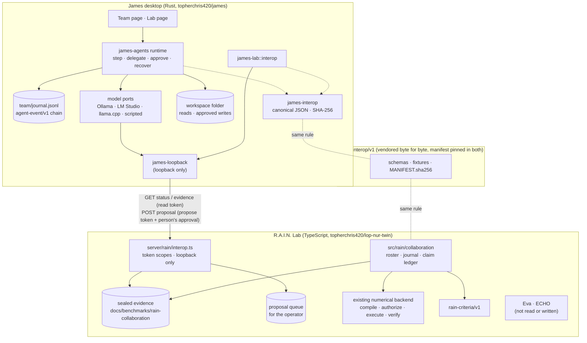

# Multi-agent James and R.A.I.N.: joint design

Date: 2026-11-16. Status: design for the `james/zen-ritchie-qqzsdo` branches of
`topherchris420/james` and `topherchris420/lop-nur-twin`. The same document is
committed in both repositories; each repository implements only its own half.

## 1. Intent

Two complementary systems, designed together and built apart:

- **James** (desktop): an intelligence that collaborates with a person. It
  gains a team of persistent, specialised assistants that delegate to one
  another inside bounds the person can see, inspect and stop, and that never
  take a consequential action without the person's approval.
- **R.A.I.N.** (Lop Nur Twin's research runtime): an intelligence that
  investigates through reproducible experiments. It gains bounded,
  structured, auditable collaboration between research seats, where every
  conclusion stays challengeable and the registry's criteria, not agreement,
  decide.

They meet only through an explicit, versioned, least-privilege interface that
either side can switch off. Neither depends on the other to run.

Anti-goals (a failure even if it "works"): permission bypass copied from the
reference; an agent that grants itself or another agent authority; a
simulated interface presented as working functionality; a model's prose
becoming evidence; any read or write of Eva's or ECHO's production state;
confusing the James desktop with the R.A.I.N. perspective named James.

## 2. Phase 1 findings

### 2.1 SuperBot (davidondrej/superbot at `652e100`, 2026-11-15, MIT)

About 2,000 lines of Rust (`botd` server, `botctl` CLI) plus a thin web app.

| Capability | Implemented in code | How | Weakness found |
| --- | --- | --- | --- |
| Persistent identity | Yes | SQLite `bots` row: name, look, harness, model, effort, harness session id, primary flag | No capability model; identity is a row id |
| Memory | Yes | `MEMORY.md` per bot and a shared `USER.md`, re-sent in the system prompt each run; the bot edits them itself | No provenance, no audit, no isolation: all bots share one OS user and folder |
| Delegation | Yes | `botctl ask` posts a `peer` message to the other bot's FIFO; the caller blocks up to 9 minutes, then the reply arrives later as a `reply` message | Only self-ask is refused. No depth limit or cycle check: A→B→A waits until the timeout. `from` is a self-asserted body field |
| Harness agnostic | Yes | `Adapter` trait (`bin`, `args`, `on_event`, `models`) for Claude Code, Codex, Pi CLIs mapping JSON lines to five events | **Every adapter passes a permission-bypass flag** (`--dangerously-skip-permissions`, `--dangerously-bypass-approvals-and-sandbox`) |
| Routines | Yes | 5-field cron, 15 s tick, at most once per matching minute via `last_run_at` | Runs missed while the server was down are skipped silently |
| Durable queue | Yes | `messages.status` queued/running/done; after restart queued work runs, running work is reported interrupted and **not** re-run | Good; adopted |
| Agent-to-agent | Yes | Local HTTP with one shared bearer token | The token authorises the whole API, including deleting bots |
| Execution state | Yes | In-memory run record (abort channel, status, draft), SSE | Not durable |
| Failure recovery | Yes | Run timeout, TERM then KILL of the process group, one fresh retry when a harness session is lost | — |
| Approvals | **Planned** ("soon") | — | Not built |
| Vault, per-bot limits, Slack, Grok Build/Hermes adapters | **Planned** | — | Not built |
| Computer use | Implemented per `docs/computer.md` (Xvfb screens, agent-browser) | — | "Screens are not security boundaries" |

Adopted ideas (re-implemented, not copied; attributed in `PROVENANCE.md` /
`NOTICE`): one small adapter per model harness; interrupted work reported, not
replayed; queued work survives restart; routines as data; delegation as a
message to another agent's queue. Rejected: permission bypass, shared
all-powerful token, unbounded delegation, self-edited unaudited memory.

### 2.2 Overlap already present

James already has: immutable reviewed invocations, one-use approvals bound to
an action generation, budgets and a state machine (`james-core`); an
in-memory run supervisor; loopback-only transport (`james-loopback`); local
model adapters for Ollama, LM Studio, llama.cpp (`james-models`); a read-only
Lab client (`james-lab`, `GET /api/rain/status`, `GET /api/rain/discovery`).
Missing: durable identity, journal, scheduling, memory, delegation (roadmap
Phase 5, "not started").

R.A.I.N. already has: seats (`autonomy/roles.ts`, with the **critic seat
unassigned**), decision records, a bounded autonomy controller, a durable
bounded session scheduler, an advisory four-perspective deliberation panel,
the registry's `rain-criteria/v1` evaluator, deterministic backends with
digest-bound authorization (numerical oscillator, fly, civilization),
`refuseOriginal` for Eva and ECHO, and Python cross-lab studies with ATLAS
export. Missing: seats that independently challenge, falsify, replicate and
verify; structured inter-seat messages; a claim lifecycle in which a
conclusion stays contestable; a measured comparison of workflows.

### 2.3 Shared versus independent

| Shared specification (`agent-interop/v1`) | Independent per system |
| --- | --- |
| Canonical JSON and SHA-256 digest rule | Runtime (Rust threads in James; TypeScript in R.A.I.N.) |
| Field semantics of identity, task, event, memory, approval records | Storage (James: hash-chained JSONL journal; R.A.I.N.: generated records and its registry) |
| Interop endpoints and their envelopes | Model adapters, schedulers, authorization mechanics |
| Golden fixtures both test suites check | Deployment, UI, language |

The specification is vendored byte for byte into `docs/interop/agent-interop-v1/`
of each repository with a SHA-256 manifest that both test suites pin. A third
repository is not justified: the contract is small, data-only and changes
rarely, and a pinned copy detects drift without a package to publish.

## 3. Approaches considered

1. **Shared runtime package** (one Rust crate compiled to WASM for the lab).
   Rejected: forces one language and release cycle on two systems with
   different safety models, and the lab's rules forbid a second path to its
   simulators.
2. **Message bus between the systems** (both connect to a broker).
   Rejected: adds a always-on third component, breaks standalone operation,
   and widens the attack surface.
3. **Shared contract, independent runtimes, optional loopback interface**
   (chosen). Each side implements the contract natively and is tested against
   the same golden fixtures; interop is a few authenticated, scoped HTTP
   routes that the Lab serves only when an operator configures them.

## 4. James design

New crate `crates/james-agents` (Rust 1.85, `std` + `serde`, `serde_json`,
`sha2`; no async runtime, matching the desktop's threads-and-channels design):

- `canonical`: ECMAScript-compatible canonical JSON and SHA-256 (keys in
  UTF-16 order, JavaScript number formatting), checked against fixtures the
  lab's own `canonicalJson` produced.
- `journal`: append-only JSONL, each record hash-chained (`prev`, `sha256`),
  fsync per append, a torn final line detected and quarantined on open. All
  state is a fold over the journal; nothing else is authoritative.
- `identity`: persistent agent profiles with a closed capability set
  (`read_workspace`, `draft`, `propose_write`, `delegate`, `review`,
  `remember`). Built-in team: Coordinator, Researcher, Writer, Reviewer.
- `memory`: entries scoped to an agent, a task, or the team, each with
  provenance (author agent, task, generation `model`/`scripted`/`user`/`host`,
  cited sources). Content lives in content-addressed files so **Forget**
  deletes the bytes while the journal keeps a tombstone. Reads are filtered by
  scope at the host; an agent cannot name a scope it does not hold.
- `task`: a tree of tasks. Delegation is validated by the host: assignee has
  the capability, depth ≤ limit, the assignee is not an ancestor (no cycles),
  and the child budget is carved out of the parent's remaining budget, so a
  delegation can never enlarge authority or spend.
- `approval`: consequential actions (writing a file) become approval requests
  bound to the SHA-256 of the exact action and the target's current content.
  Only the person can decide; approval is re-checked at apply time and fails
  if the file changed. Agents have no handle to decide.
- `tools`: bounded operations: list and read inside a chosen workspace root
  (canonicalised, no traversal, no symlink escape, size-bounded), and staged
  writes that apply only through an approval.
- `schedule`: routines (5-field cron, local time). A routine run creates a
  task; it never pre-approves anything. Runs missed while James was closed are
  recorded as `missed` and not silently run.
- `runtime`: a step-driven supervisor: each `step()` advances one task by one
  model call or one tool action, so the desktop can drive it from a worker
  thread and tests can drive it deterministically. Cancel cascades to
  descendants and aborts an in-flight model call. On open, tasks that were
  running are marked `interrupted` and wait for the person; queued tasks
  continue; granted-but-unapplied approvals are reconciled by checking the
  file (applied, not applied, or unknown → ask).
- `model`: `ModelPort` trait; `LocalModel` wraps `james-models` (Ollama, LM
  Studio, llama.cpp over loopback); `ScriptedModel` is deterministic and
  labelled `scripted` in every record. External harnesses are deliberately
  not shipped (see limits).

Desktop: a **Team** page (Ctrl+7) shows the roster, task tree with live
status, each task's event timeline, the memory inspector (scope, provenance,
Forget), pending approvals with the exact content and digest, and routines.
Starting a task uses the model chosen in Settings. The octopus, voice,
conversation and existing review paths are untouched.

Demo A: `cargo run -p james-agents --example team_demo` (scripted, offline)
and `-- --llama-cpp 8080 <model>` (real local model). The Coordinator
delegates to Researcher (reads files through bounded tools), Writer (drafts),
Reviewer (checks that every cited line exists); the Writer's file write waits
for approval; the trace is printed and the hash chain verified.

## 5. R.A.I.N. design

New server-side module `src/rain/collaboration/` (pure; no fetch, process,
filesystem or simulator mutation; persistence by the calling script):

- `roster`: research responsibilities assigned to the existing perspectives
  by name, never by editing them: James → hypothesis generation; Luca →
  experimental design; Jasmine → independent criticism and falsification;
  Elena → evidence verification; host seats → execution, replication,
  archiving. The roster is versioned and its digest is in every record.
- `messages`: a closed vocabulary (`hypothesis`, `design`, `challenge`,
  `falsification`, `replication`, `verification`, `revision`, `concession`)
  with `generation`, `in_reply_to`, and a hash chain.
- `claims`: institutional memory as a claim ledger. A claim's standing is
  derived from evidence and open challenges (`supported`, `refuted`,
  `contested`, `insufficient`); a revision supersedes, never deletes; any seat
  may challenge at any time and only a new admitted run resolves a challenge.
- `episode`: a bounded research episode over the **existing numerical
  oscillator backend** (`scientific/numerical.ts`): plans compiled by the
  existing compiler, authorised with the existing digest ritual (labelled
  `Scripted.DemoOperator` for the demonstration only), executed by the
  existing executor, judged by `rain-criteria/v1`, re-verified with
  `verifyNumericalRecord`.
- `evaluation`: a preregistered three-arm comparison (fixed workflow,
  single-agent, multi-agent) on cases generated from seeds derived after the
  protocol is frozen, with ground truth from the backend's independent
  closed-form reference, equal simulation budgets, and metrics for
  conclusion accuracy, error detection, false alarms, reproducibility and
  cost. Results are written by a script and reproduced byte for byte by
  `--check`. Negative and inconclusive results are published.
- Demo B: the "displacement resonance occurs at the undamped natural
  frequency" assumption is proposed, challenged with a discriminating design,
  and a correction is tested on held-out parameters against preregistered
  success/failure criteria. The correction is textbook physics; the claim is
  that the protocol caught and tested it, not that it is new science.

Isolation: the module imports nothing from `life/`, `garden/`, `fly/`,
`firstContact/` or `deploy/`; every subject id passes `refuseOriginal`;
`isolation.test.ts` style scans enforce both.

Interop (served by the local runtime only, off unless configured):
`GET /api/rain/interop/v1/status`, `GET /api/rain/interop/v1/evidence?episode=`,
`POST /api/rain/interop/v1/proposals` (stored for operator review; never
authorised or run by this path). Per-scope bearer tokens
(`RAIN_INTEROP_READ_TOKEN`, `RAIN_INTEROP_PROPOSE_TOKEN`), constant-time
compare, loopback peers only, bounded bodies.

James side: `james-lab::interop` fetches and validates the envelopes,
recomputes record digests with the shared canonical rule, and shows evidence
with provenance and limitations. Tokens are held in memory only. A proposal
submission needs James's own approval gate first; the Lab's policy then
queues it. Two independent gates.

### Architecture as built

## 6. Limits stated up front

- No OS sandbox. Bounded tools are enforced by James's host code, not the OS.
- No external (cloud) model or harness adapter ships; the trait allows one,
  but ADR 008 requires a separate, labelled transport and explicit opt-in.
- Desktop automation keeps its existing single reviewed-input path; agents do
  not drive the mouse or keyboard.
- R.A.I.N.'s rule-based evaluation measures the protocols as specified; it is
  not evidence about language-model agents. A model arm is reported only if a
  real local model run was made, with its receipts.
- Interop authentication is a shared secret on loopback, not identity.
